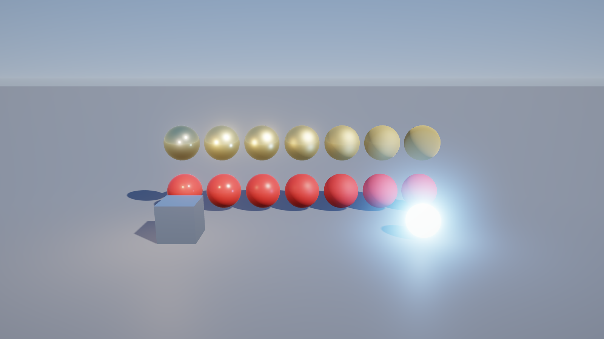
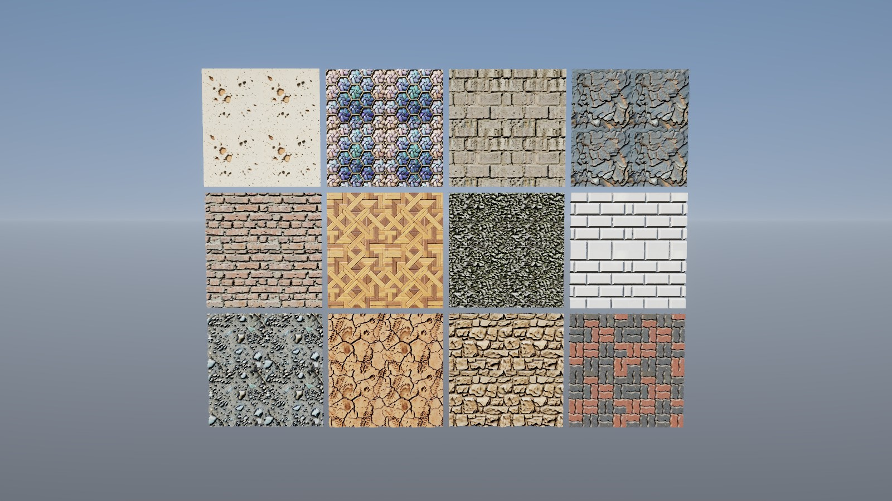
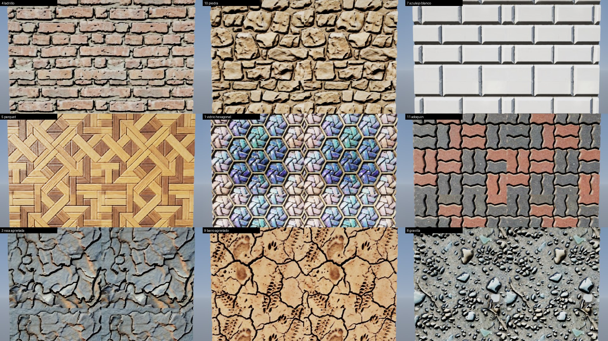

# GB Engine

Motor gráfico 3D en C++20 (OpenGL primero), pensado para poder ser usado y mejorado por agentes además de personas.

## Compilar (Windows / Linux)

```
cmake -S . -B build -DCMAKE_BUILD_TYPE=Release
cmake --build build --config Release
ctest --test-dir build -C Release --output-on-failure
./build/Sandbox/Sandbox --frames=3     # Windows: build\Sandbox\Release\Sandbox.exe
```

Las dependencias (spdlog, GLFW 3.4, stb) se descargan con CMake FetchContent; glad (OpenGL 4.5 core) está generado en `Engine/vendor/glad`.
En Linux hacen falta las cabeceras de X11: `sudo apt install xorg-dev libgl1-mesa-dev`.

## Ejecutar sin pantalla (agentes / CI)

```
xvfb-run -a ./build/Sandbox/Sandbox --hidden --frames=5 --screenshot=shot.png   # Linux
Sandbox.exe --hidden --frames=5 --screenshot=shot.png                           # Windows
```
Opciones: `--frames=N`, `--screenshot=file.png`, `--hidden`, `--novsync`. Sandbox: WASD/flechas o stick izquierdo mueven el triángulo, Esc/Back salen.

## Estructura

- `Engine/` – biblioteca estática `GB`
- `Sandbox/` – aplicación de ejemplo
- `tests/` – tests (ctest)

## Render (Fase 2)



Forward PBR (Cook-Torrance GGX, metálico/rugosidad), sol con sombras PCF, luces puntuales, cielo procedural como iluminación ambiental/reflejos, MSAA 4x en HDR (RGBA16F), bloom y tonemapping ACES.
### Prueba de texturas (atlas de 12 materiales)

`Sandbox --scene=textures` monta una galería 4×3 sobre cuadrados subdivididos (51 200 triángulos cada uno) con albedo sRGB, normal mapping y desplazamiento de vértices por el mapa de altura (que también atenúa las grietas como AO).
`--tile=N` (0-11) muestra una tesela grande, `--grid=N`, `--height=H`, `--nodisplace`, `--flipy`, `--noflipx`.




Notas sobre los atlas de `assets/textures/` (512×384, teselas de 128 px):
- Tienen una franja negra de ~3 px entre teselas y en los bordes: se recorta con 4 px de margen (si no, aparecen costuras oscuras al repetir).
- Las normales son OpenGL (Y+) pero el canal rojo está invertido respecto al mapa de altura (medido en 6 teselas); `NormalFlipX` lo corrige.
- Las teselas no son perfectamente «tileables» (los bordes no casan) y a 120 px por tesela se nota la baja resolución de cerca. No hay mapas de rugosidad/metal: se usa un valor por tesela.

Pendiente de esta fase: IBL real con HDRI, texturas (llegan con glTF), SSAO, CSM y luces con sombras.
Sandbox: flechas/WASD o stick derecho orbitan, Q/E zoom.

## Importación glTF (Fase 3)

`GB::Model::Load("modelo.glb")` carga glTF 2.0 (`.glb`/`.gltf`, exportado de Blender: *File > Export > glTF 2.0*) y `model->AddToScene(scene)` lo añade al renderer.

Soportado: mallas (normales/tangentes generadas si faltan), jerarquía de nodos, materiales metálico-rugosidad con texturas (color base, metal/rugosidad, normal, oclusión, emisivo), modos alfa (opaco, máscara, mezcla ordenada), doble cara, `KHR_materials_emissive_strength`, texturas embebidas o externas.
Pendiente: morph targets, luces del archivo, UV distintas de UV0, `KHR_texture_transform`.

`Sandbox --scene=model --model=ruta.glb [--yaw=GRADOS] [--nofloor]` (por defecto el casco de `assets/models`, CC BY 4.0).
Validado con el casco y modelos de prueba de Khronos (BoomBox, AlphaBlendModeTest, NormalTangentMirrorTest) y con un `.glb` generado por `tools/make_test_gltf.py` para el test automático.


## Animación (Fase 4)

```cpp
auto model = GB::Model::Load("personaje.glb");          // asset inmutable y compartible
GB::ModelInstance actor(*model);                        // estado de reproducción + pose
actor.Play("Walk");                                     // bucle por defecto, mezcla de 0,2 s
actor.Play("Run", true, 0.3f);                          // cross-fade de 0,3 s desde la animación actual
actor.Update(dt);                                       // cada frame
actor.AddToScene(scene);                                // objetos con la pose actual (skinning en GPU)
```

Animación de nodos y esqueletal (skinning por GPU con SSBO de huesos, también en las sombras), interpolación STEP / LINEAR (slerp) / CUBICSPLINE, bucle o una sola pasada, velocidad, pausa, `SetTime` y mezcla entre clips.
`Sandbox --scene=model --model=x.glb --anim=Walk --time=0.3` (congela ese instante, ideal para capturas); teclas 1-9 cambian de clip y Espacio pausa.
Pendiente: morph targets (blend shapes), máquina de estados / blend trees, retargeting.

### Grabar un clip

```
xvfb-run -a ./build/Sandbox/Sandbox --scene=model --model=Fox.glb --playlist=Survey,Walk,Run --switch=1.2 \
    --orbit=25 --size=960x540 --hidden --frames=96 --fps=24 --record=frames
ffmpeg -framerate 24 -i frames/frame_%05d.png -c:v libx264 -pix_fmt yuv420p clip.mp4
```
`--record=DIR` guarda un PNG por frame con paso de tiempo fijo (1/fps), así el resultado es determinista aunque el render sea lento.


## Cámaras (Fase 5)

`GB::Camera`: perspectiva u ortográfica, `Camera::Blend(a, b, t)` para transiciones. Controladores (usables por código o por entrada):
- `OrbitController`: órbita alrededor de un punto (ratón: izq. rota, der./centro desplaza, rueda zoom; flechas/WASD, Q/E, stick derecho).
- `FlyController`: vuelo libre (WASD + Q/E, Shift acelera, botón derecho mira, rueda cambia la velocidad, sticks del mando).
- `FollowController`: cámara de seguimiento en tercera persona con suavizado independiente de los fps.
- Cámaras del glTF (p. ej. las de Blender, perspectiva u ortográficas, **animadas con el archivo**): `model->GetCameras()` y `instance.GetCamera(i, camera)`.

Sandbox: `C` (o botón Y del mando) recorre órbita / vuelo / cámaras del archivo con transición suave; `--camera=orbit|fly|N`.
`tools/add_camera_rig.py in.glb out.glb` añade a un modelo una plataforma de cámaras de demostración (giro 360°, travelling, cenital ortográfica).

## Partículas (Fase 6)

```cpp
GB::ParticleSystem fire(GB::ParticlePresets::Fire());   // Fire, Smoke, Sparks, Explosion, Snow, Magic
fire.SetPosition({0, 0.2f, 0});
scene.Particles.push_back(&fire);                        // el Renderer las dibuja tras la geometría
fire.Update(dt);                                         // cada frame
```

Simulación en CPU **determinista** (misma semilla + mismos `Update` = mismas partículas), render por instancias en GPU (billboards).
`ParticleEmitterDesc`: formas de emisión (punto, esfera, cono, caja), tasa y ráfagas, bucle/duración, vida/velocidad/tamaño aleatorios por rango, gravedad (negativa = flotabilidad), viento, rozamiento, espacio local o mundial, color e intensidad HDR (alimenta el bloom), fundido, rotación, **estiramiento por velocidad** (chispas), mezcla aditiva o alfa (ordenada), sprites procedurales, textura propia y hoja de sprites (flipbook).
Sandbox: `--scene=particles` (hoguera nocturna: fuego, humo, chispas con luz parpadeante, nieve, orbe mágico y una explosión periódica; tecla B = explosión; `--simulate=S` calienta la simulación antes del primer frame).
Pendiente: partículas suaves (fade contra la geometría, necesita la profundidad de la escena: hoy los sprites grandes se recortan con el suelo), colisiones, emisión desde mallas, sombras de partículas, GPU compute para cientos de miles.

## Clima y efectos atmosféricos (Fase 7A)

```cpp
GB::Weather weather;                                 // lluvia, nieve, polvo, tormenta de arena, tormenta eléctrica, tornado
weather.SetBase(scene);                              // captura el entorno y las partículas propios de la escena
weather.SetPreset(GB::WeatherPreset::Thunderstorm);  // o SetRain(0.7), SetWind({8,0,2}), SetTornado(1)...
weather.Update(dt, camera);                          // transiciones suaves; los volúmenes siguen a la cámara
weather.Apply(scene);                                // cielo cubierto, niebla, suelo mojado/nevado, partículas, relámpago
for (auto& t : weather.GetLightning().TakeThunder()) // truenos con retardo = distancia / 343 m/s (para el audio)
    ...;
```

- **Lluvia** (miles de gotas alargadas con la caída inclinada por el viento), **salpicaduras** donde impactan, **neblina** a ras de suelo, **nieve** con turbulencia que se acumula sobre las superficies, **polvo**, **tormenta de arena** y **tornado** (embudo con vórtice, anillo de polvo, escombros y nube).
- **Relámpagos** procedurales con ramificaciones (`GB::Lightning`): parpadeo de varios pulsos, luz y destello del cielo, y eventos de trueno con retardo y volumen según la distancia. Se dirigen hacia donde mira la cámara.
- **Renderer**: niebla exponencial con altura, superficies mojadas (más oscuras y brillantes), cobertura de nieve en superficies orientadas hacia arriba, **partículas suaves** (se funden con la geometría) y partículas con niebla.
- **Partículas**: turbulencia (ruido 3D), vórtice (giro, atracción, elevación), colisión con el suelo (matar o rebotar) con emisor de impactos (`SetHitEmitter`), `EmitAt`, sprite `Streak`.
- Sandbox: `--scene=weather --weather=clear|lightrain|rain|storm|snow|blizzard|dust|sandstorm|tornado` (teclas 1-9, L = rayo, `--strike`).

## Hoja de ruta

0. Base CMake, log, bucle headless, CI  ✔
1. Ventana (GLFW), OpenGL 4.5, input teclado/mando, capturas PNG  ✔
2. Render PBR, luces, sombras, HDR/bloom  ✔ (primera pasada, ver abajo)
3. Importación glTF 2.0 (Blender)  ✔
4. Animación esquelética  ✔ · cámaras  ✔ · partículas  ✔ · audio
5. Editor (ImGui) y API para agentes (headless, capturas PNG, escenas en texto)
