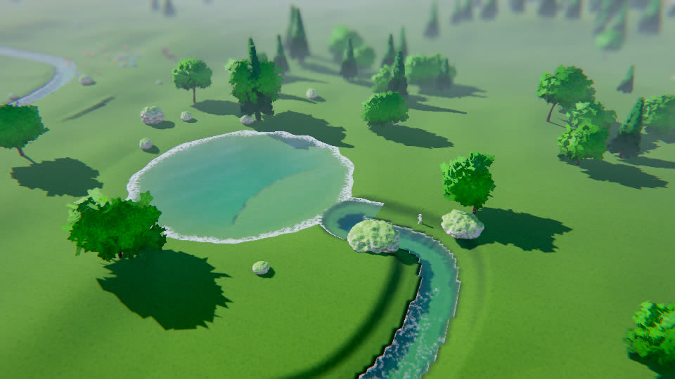

# GB Engine

[](https://github.com/guillermoblanca/Engine/actions/workflows/ci.yml)
[](LICENSE)

Motor gráfico 3D en C++20 sobre OpenGL 4.5, para Windows y Linux. Está pensado para poder usarse, probarse y mejorarse tanto por personas como por agentes: todo el motor se ejecuta también **sin ventana** (capturas de pantalla, tests y QA visual desde la línea de comandos).



## Características

- **Render**: PBR forward (Cook-Torrance GGX), sombras, luces puntuales, cielo procedural con ciclo día/noche, entorno HDRI, reflejos en pantalla (SSR), MSAA en HDR, bloom, SSAO, profundidad de campo, auto-exposición y *tonemapping*.
- **Mundo procedural**: terreno, erosión, ríos, lagos, rocas, bosques con biomas, hierba y agua con olas y espuma.
- **Clima y efectos**: lluvia, nieve, tormenta con rayos, tormenta de arena, tornado y partículas.
- **Física y destrucción**: cuerpos rígidos, flotabilidad, vórtices y objetos rompibles.
- **Modelos y animación**: importación glTF 2.0 y FBX, animación esquelética, análisis de clips de locomoción y cámaras.
- **Audio**: sintetizadores deterministas, mezclador 3D por software y salida por dispositivo (con *backend* silencioso en CI).
- **Editor** (Dear ImGui): jerarquía, inspector, selección, gizmo, deshacer/rehacer, escenas JSON, consola y scripts; todo accesible por comandos.
- **QA automatizado**: imágenes y datos de referencia, barridos de semillas y tests de CPU y de GL.

## Empezar

Requisitos: CMake 3.20 o superior y un compilador con C++20 (MSVC 2022, GCC o Clang). En Linux hacen falta las cabeceras de X11 y Mesa:

```bash
sudo apt install xorg-dev libgl1-mesa-dev
```

Las dependencias se descargan con CMake `FetchContent` (versiones fijadas); glad (OpenGL 4.5 core) viene generado en `Engine/vendor/glad`.

```bash
cmake -S . -B build -DCMAKE_BUILD_TYPE=Release
cmake --build build --config Release
ctest --test-dir build -C Release --output-on-failure
```

Ejecutables (en Windows, `build\<Proyecto>\Release\<Nombre>.exe`):

```bash
./build/Sandbox/Sandbox --scene=showcase          # demo completa
./build/Editor/Editor                             # editor
```

### Sin pantalla (agentes y CI)

```bash
xvfb-run -a ./build/Sandbox/Sandbox --scene=showcase --hidden --frames=5 --screenshot=shot.png   # Linux
Sandbox.exe --scene=showcase --hidden --frames=5 --screenshot=shot.png                          # Windows
xvfb-run -a ./build/Editor/Editor --hidden --quality=low "--exec=generate temperate 5; time 18; wait 4; shot_ui ui.png; quit"
```

Opciones habituales del Sandbox: `--scene=<nombre>`, `--frames=N`, `--screenshot=archivo.png`, `--hidden`, `--novsync`, `--quality=low|medium|high|ultra`. La lista de escenas y sus opciones está en la [documentación](#documentación).

## Estructura del repositorio

| Carpeta | Contenido |
|---|---|
| `Engine/` | Biblioteca estática `GB` (render, mundo, física, audio, animación, entidades, QA) |
| `Editor/` | Editor Dear ImGui y sus tests |
| `Sandbox/` | Aplicación de ejemplo con las escenas de prueba y la demo |
| `tests/` | Tests (`ctest`), imágenes y datos de referencia (`tests/golden`) |
| `assets/` | Modelos, texturas y entornos HDRI de ejemplo |
| `tools/` | Scripts auxiliares (generadores de modelos de prueba, informe de QA) |
| `docs/` | Documentación por temas e imágenes |

## Documentación

| Tema | Documento |
|---|---|
| Render, luz, cielo, reflejos, postproceso y demo | [docs/render.md](docs/render.md) |
| glTF, FBX, animación y cámaras | [docs/modelos-y-animacion.md](docs/modelos-y-animacion.md) |
| Locomoción: estudio del pack Mixamo | [docs/ANIMACION_LOCOMOCION.md](docs/ANIMACION_LOCOMOCION.md) |
| Arquitectura del sistema de animación completo (investigación) | [docs/ANIMACION_SISTEMA_COMPLETO.md](docs/ANIMACION_SISTEMA_COMPLETO.md) |
| Habilidades de juego tipo GAS y escenario del huerto (`garden build`, `ability ...`) | [docs/habilidades.md](docs/habilidades.md) |
| Animaciones que faltan en los packs y qué se usa mientras tanto | [docs/ANIMACIONES_PENDIENTES.md](docs/ANIMACIONES_PENDIENTES.md) |
| Partidas guardadas, migraciones, guardado diferencial y repeticiones (`save`, `load`, `replay`) | [docs/GUARDADO.md](docs/GUARDADO.md) |
| Objetos, inventario, recursos y recetas | [docs/OBJETOS.md](docs/OBJETOS.md) |
| Recursos repartidos por el mundo generado, por bioma (`resources world`) | [docs/RECURSOS_MUNDO.md](docs/RECURSOS_MUNDO.md) |
| La primera tribu: trabajadores autónomos (`tribe build`) | [docs/TRIBU.md](docs/TRIBU.md) |
| Percepción, necesidades y cerebro de utilidad de los agentes (`ai`) | [docs/IA.md](docs/IA.md) |
| Navegación: cuadrícula con costes, caminos y evitación (`nav`) | [docs/NAVEGACION.md](docs/NAVEGACION.md) |
| Interactivos con estado: fogata, pozo, puerta (`interactives build`) | [docs/INTERACTIVOS.md](docs/INTERACTIVOS.md) |
| Estaciones y ecología: conejos que comen, crían y se mueren de hambre (`ecology`) | [docs/ECOLOGIA.md](docs/ECOLOGIA.md) |
| Propuesta de habilidades y economía: herramientas, materiales, oficios, agricultura, conservación y edificios | [docs/PROPUESTA_HABILIDADES_Y_ECONOMIA.md](docs/PROPUESTA_HABILIDADES_Y_ECONOMIA.md) |
| **Wiki del proyecto** (habilidades, atributos, necesidades, roles, estaciones y documentos, con buscador): `docs/wiki/index.html` | [docs/wiki/README.md](docs/wiki/README.md) |
| Partículas y clima | [docs/efectos.md](docs/efectos.md) |
| Terreno, agua, vegetación, erosión y mundos procedurales | [docs/mundo.md](docs/mundo.md) |
| Física y destrucción | [docs/fisica.md](docs/fisica.md) |
| Audio | [docs/audio.md](docs/audio.md) |
| Editor, entidades y escenas | [docs/editor.md](docs/editor.md) |
| QA automatizado y imágenes de referencia | [docs/qa.md](docs/qa.md) |
| QA de la simulación: barrido de semillas con tribus, invariantes, `qa sim` y demos por hito | [docs/QA_SIMULACION.md](docs/QA_SIMULACION.md) |

## Pruebas y calidad

`ctest` ejecuta tests de CPU (lógica pura, sin ventana) y de GL (render headless). Las comparaciones de imagen usan referencias en `tests/golden`; una referencia dentro de `tests/golden/images/<plataforma>/` tiene prioridad sobre la genérica, porque el render del follaje varía entre controladores y GPU (el CI de Linux usa Mesa por software).

Tras un cambio visual **intencionado**, regenera las referencias y revísalas antes de commitear:

```bash
GB_UPDATE_GOLDEN=1 ctest --test-dir build -C Release -R golden
```

Más detalles en [docs/qa.md](docs/qa.md).

## Contribuir

- C++20 y CMake; objetivo Windows y Linux. Espacio de nombres `GB`, macros `GB_*`.
- Antes de commitear: configurar con `-DGB_WARNINGS_AS_ERRORS=ON`, compilar y pasar `ctest`.
- Includes con `/` (`#include "GB/..."`), nunca `\`. Sin `__declspec(dllexport)` (el motor es una biblioteca estática).
- No versionar binarios ni salidas de compilación. Las dependencias entran por `FetchContent` con versión fija.
- Todo código nuevo del motor debe poder ejecutarse sin ventana, para tests y QA por capturas.

Las normas completas para agentes están en [CLAUDE.md](CLAUDE.md).

## Hoja de ruta

Hecho:

- Base CMake, registro de eventos, bucle headless y CI en Windows y Linux.
- Ventana, OpenGL 4.5, entrada de teclado y mando, capturas PNG.
- Render PBR, sombras, HDR, postproceso, cielo, reflejos y HDRI.
- glTF y FBX, animación esquelética, mezcla de poses, blend spaces y locomoción con eventos de pasos, cámaras, partículas y audio.
- Terreno, ríos, lagos, erosión, mundos procedurales, vegetación, física y destrucción.
- Editor con jerarquía, inspector, selección, gizmo y deshacer; escenas JSON.
- QA automatizado con referencias de imagen y de datos.
- Prototipo de personaje controlable en tercera persona (`--player`).
- Sistema de habilidades tipo GAS y huerto jugable, objetos, inventario y recursos del mundo (datos en paquetes de era: `assets/data/era1.pack.json`, ver `docs/PAQUETES.md`), interactivos con estado, estaciones y ecología básica.
- Partidas guardadas con migraciones, guardado diferencial y repeticiones deterministas.
- La primera tribu: trabajadores autónomos con paneles de estado en el editor.
- Pase de calidad con cifras de rendimiento: [docs/INFORME_CALIDAD.md](docs/INFORME_CALIDAD.md).

En curso o previsto:

- Audio ligado a entidades y ambiente en el editor.
- Calidad del agua y del terreno cerca de la cámara; árboles, palmeras y rocas procedurales.
- Medición en GPU del alfa a cobertura del follaje (el refinado de orillas ya está medido: [docs/mundo.md](docs/mundo.md)).
- API para agentes sobre el editor.
- **Mundo vivo de clanes**: sociedades de NPC que construyen, descubren tecnología, tienen hijos, comercian y guerrean, con el jugador como un miembro más y con avance por eras hasta la espacial. El plan completo, por hitos, con criterios de aceptación y matriz de cobertura, está en [docs/PLAN_SOCIEDAD_VIVA.md](docs/PLAN_SOCIEDAD_VIVA.md).

## Licencia

Apache License 2.0. Consulta [LICENSE](LICENSE).
