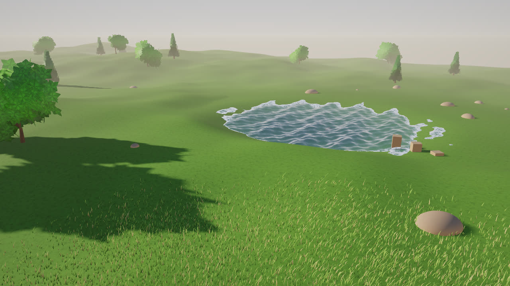
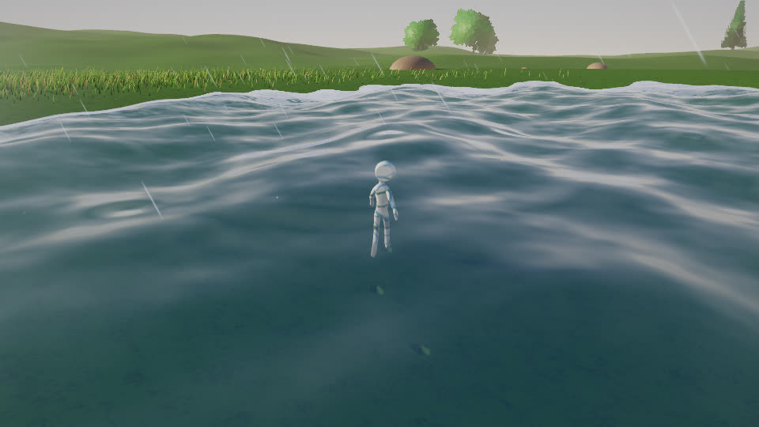
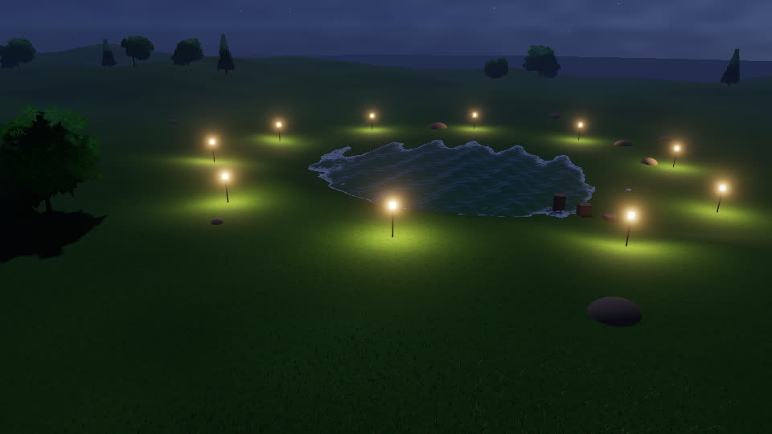
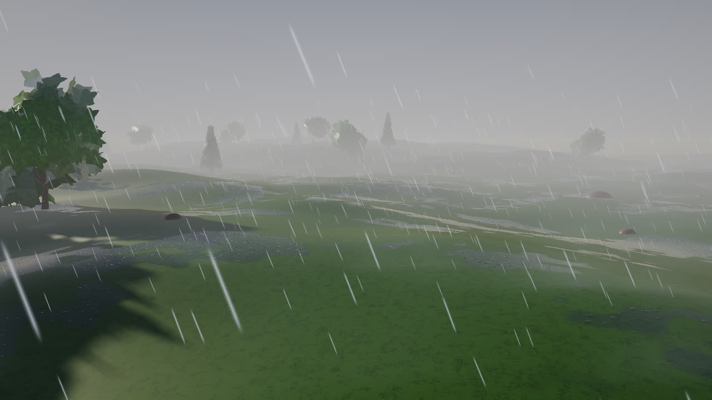
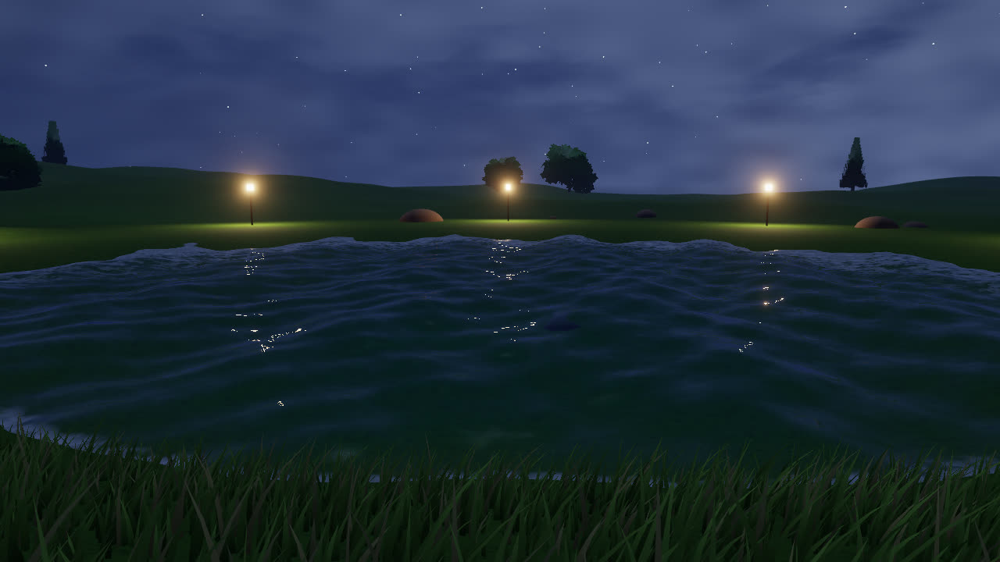
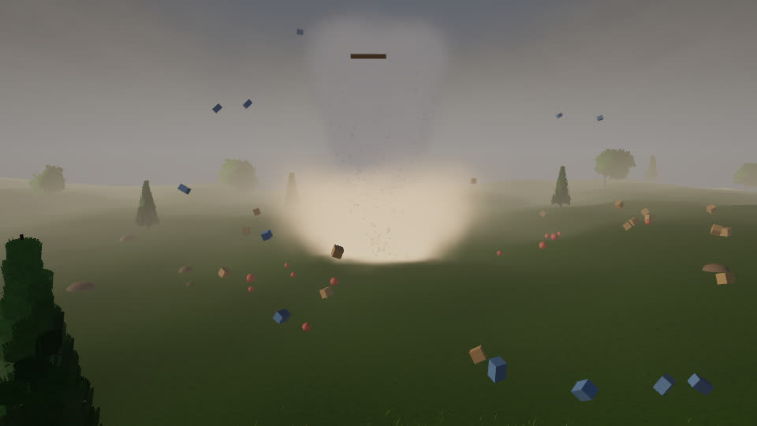
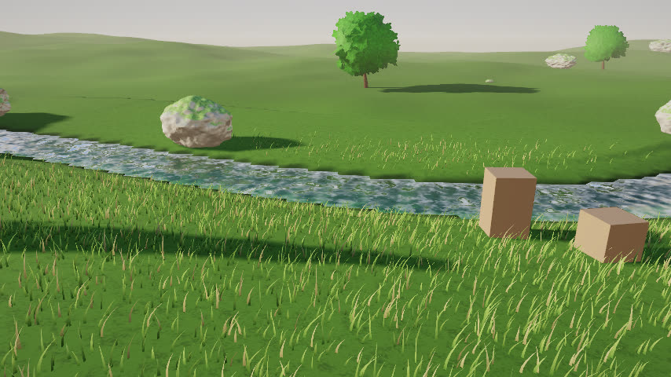
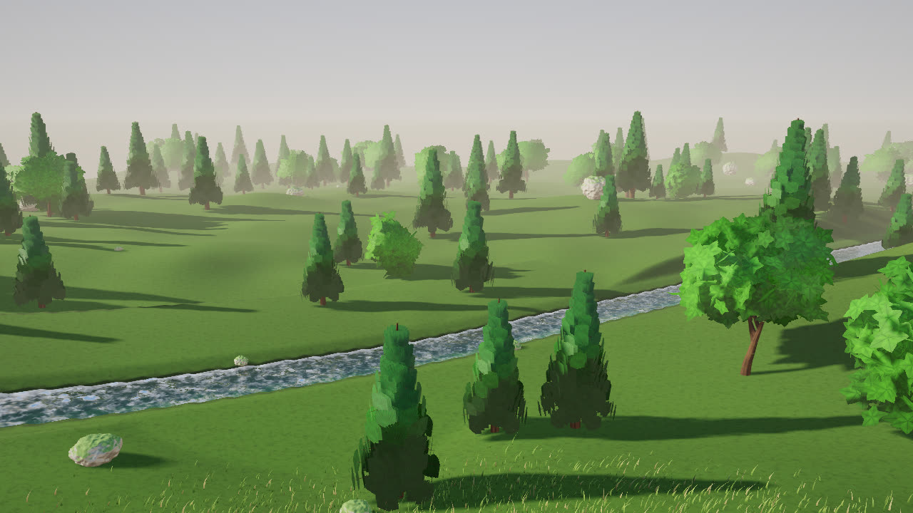
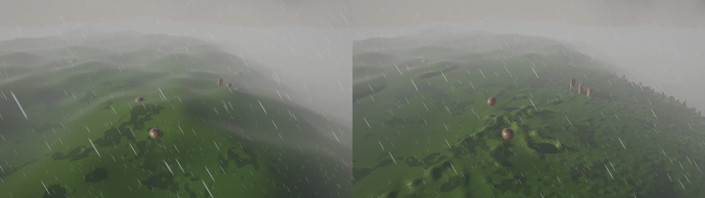
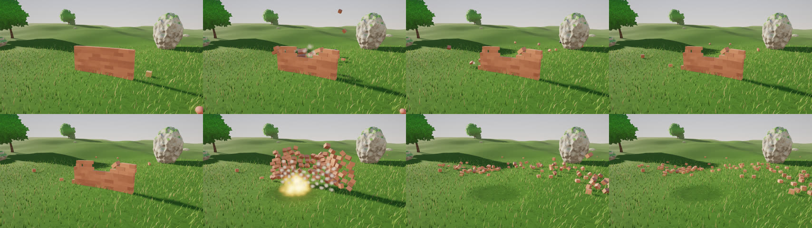

# GB Engine

Motor gráfico 3D en C++20 (OpenGL primero), pensado para poder ser usado y mejorado por agentes además de personas.

## Compilar (Windows / Linux)

```
cmake -S . -B build -DCMAKE_BUILD_TYPE=Release
cmake --build build --config Release
ctest --test-dir build -C Release --output-on-failure
./build/Sandbox/Sandbox --frames=3     # Windows: build\Sandbox\Release\Sandbox.exe
```

Las dependencias (spdlog, GLFW 3.4, stb) se descargan con CMake FetchContent; glad (OpenGL 4.5 core) está generado en `Engine/vendor/glad`.
En Linux hacen falta las cabeceras de X11: `sudo apt install xorg-dev libgl1-mesa-dev`.

## Ejecutar sin pantalla (agentes / CI)

```
xvfb-run -a ./build/Sandbox/Sandbox --hidden --frames=5 --screenshot=shot.png   # Linux
Sandbox.exe --hidden --frames=5 --screenshot=shot.png                           # Windows
```
Opciones: `--frames=N`, `--screenshot=file.png`, `--hidden`, `--novsync`. Sandbox: WASD/flechas o stick izquierdo mueven el triángulo, Esc/Back salen.

## Estructura

- `Engine/` – biblioteca estática `GB`
- `Sandbox/` – aplicación de ejemplo
- `tests/` – tests (ctest)

## Render (Fase 2)


Forward PBR (Cook-Torrance GGX, metálico/rugosidad), sol con sombras PCF, luces puntuales, cielo procedural como iluminación ambiental/reflejos, MSAA 4x en HDR (RGBA16F), bloom y tonemapping ACES.
### Prueba de texturas (atlas de 12 materiales)

`Sandbox --scene=textures` monta una galería 4×3 sobre cuadrados subdivididos (51 200 triángulos cada uno) con albedo sRGB, normal mapping y desplazamiento de vértices por el mapa de altura (que también atenúa las grietas como AO).
`--tile=N` (0-11) muestra una tesela grande, `--grid=N`, `--height=H`, `--nodisplace`, `--flipy`, `--noflipx`.


Notas sobre los atlas de `assets/textures/` (512×384, teselas de 128 px):
- Tienen una franja negra de ~3 px entre teselas y en los bordes: se recorta con 4 px de margen (si no, aparecen costuras oscuras al repetir).
- Las normales son OpenGL (Y+) pero el canal rojo está invertido respecto al mapa de altura (medido en 6 teselas); `NormalFlipX` lo corrige.
- Las teselas no son perfectamente «tileables» (los bordes no casan) y a 120 px por tesela se nota la baja resolución de cerca. No hay mapas de rugosidad/metal: se usa un valor por tesela.

Pendiente de esta fase: IBL real con HDRI, texturas (llegan con glTF), SSAO, CSM y luces con sombras.
Sandbox: flechas/WASD o stick derecho orbitan, Q/E zoom.

## Importación glTF (Fase 3)

`GB::Model::Load("modelo.glb")` carga glTF 2.0 (`.glb`/`.gltf`, exportado de Blender: *File > Export > glTF 2.0*) y `model->AddToScene(scene)` lo añade al renderer.

Soportado: mallas (normales/tangentes generadas si faltan), jerarquía de nodos, materiales metálico-rugosidad con texturas (color base, metal/rugosidad, normal, oclusión, emisivo), modos alfa (opaco, máscara, mezcla ordenada), doble cara, `KHR_materials_emissive_strength`, texturas embebidas o externas.
Pendiente: morph targets, luces del archivo, UV distintas de UV0, `KHR_texture_transform`.

`Sandbox --scene=model --model=ruta.glb [--yaw=GRADOS] [--nofloor]` (por defecto el casco de `assets/models`, CC BY 4.0).
Validado con el casco y modelos de prueba de Khronos (BoomBox, AlphaBlendModeTest, NormalTangentMirrorTest) y con un `.glb` generado por `tools/make_test_gltf.py` para el test automático.


## Animación (Fase 4)

```cpp
auto model = GB::Model::Load("personaje.glb");          // asset inmutable y compartible
GB::ModelInstance actor(*model);                        // estado de reproducción + pose
actor.Play("Walk");                                     // bucle por defecto, mezcla de 0,2 s
actor.Play("Run", true, 0.3f);                          // cross-fade de 0,3 s desde la animación actual
actor.Update(dt);                                       // cada frame
actor.AddToScene(scene);                                // objetos con la pose actual (skinning en GPU)
```

Animación de nodos y esqueletal (skinning por GPU con SSBO de huesos, también en las sombras), interpolación STEP / LINEAR (slerp) / CUBICSPLINE, bucle o una sola pasada, velocidad, pausa, `SetTime` y mezcla entre clips.
`Sandbox --scene=model --model=x.glb --anim=Walk --time=0.3` (congela ese instante, ideal para capturas); teclas 1-9 cambian de clip y Espacio pausa.
Pendiente: morph targets (blend shapes), máquina de estados / blend trees, retargeting.

### Grabar un clip

```
xvfb-run -a ./build/Sandbox/Sandbox --scene=model --model=Fox.glb --playlist=Survey,Walk,Run --switch=1.2 \
    --orbit=25 --size=960x540 --hidden --frames=96 --fps=24 --record=frames
ffmpeg -framerate 24 -i frames/frame_%05d.png -c:v libx264 -pix_fmt yuv420p clip.mp4
```
`--record=DIR` guarda un PNG por frame con paso de tiempo fijo (1/fps), así el resultado es determinista aunque el render sea lento.


## Cámaras (Fase 5)

`GB::Camera`: perspectiva u ortográfica, `Camera::Blend(a, b, t)` para transiciones. Controladores (usables por código o por entrada):
- `OrbitController`: órbita alrededor de un punto (ratón: izq. rota, der./centro desplaza, rueda zoom; flechas/WASD, Q/E, stick derecho).
- `FlyController`: vuelo libre (WASD + Q/E, Shift acelera, botón derecho mira, rueda cambia la velocidad, sticks del mando).
- `FollowController`: cámara de seguimiento en tercera persona con suavizado independiente de los fps.
- Cámaras del glTF (p. ej. las de Blender, perspectiva u ortográficas, **animadas con el archivo**): `model->GetCameras()` y `instance.GetCamera(i, camera)`.

Sandbox: `C` (o botón Y del mando) recorre órbita / vuelo / cámaras del archivo con transición suave; `--camera=orbit|fly|N`.
`tools/add_camera_rig.py in.glb out.glb` añade a un modelo una plataforma de cámaras de demostración (giro 360°, travelling, cenital ortográfica).

## Partículas (Fase 6)

```cpp
GB::ParticleSystem fire(GB::ParticlePresets::Fire());   // Fire, Smoke, Sparks, Explosion, Snow, Magic
fire.SetPosition({0, 0.2f, 0});
scene.Particles.push_back(&fire);                        // el Renderer las dibuja tras la geometría
fire.Update(dt);                                         // cada frame
```

Simulación en CPU **determinista** (misma semilla + mismos `Update` = mismas partículas), render por instancias en GPU (billboards).
`ParticleEmitterDesc`: formas de emisión (punto, esfera, cono, caja), tasa y ráfagas, bucle/duración, vida/velocidad/tamaño aleatorios por rango, gravedad (negativa = flotabilidad), viento, rozamiento, espacio local o mundial, color e intensidad HDR (alimenta el bloom), fundido, rotación, **estiramiento por velocidad** (chispas), mezcla aditiva o alfa (ordenada), sprites procedurales, textura propia y hoja de sprites (flipbook).
Sandbox: `--scene=particles` (hoguera nocturna: fuego, humo, chispas con luz parpadeante, nieve, orbe mágico y una explosión periódica; tecla B = explosión; `--simulate=S` calienta la simulación antes del primer frame).
Pendiente: partículas suaves (fade contra la geometría, necesita la profundidad de la escena: hoy los sprites grandes se recortan con el suelo), colisiones, emisión desde mallas, sombras de partículas, GPU compute para cientos de miles.

## Clima y efectos atmosféricos (Fase 7A)

```cpp
GB::Weather weather;                                 // lluvia, nieve, polvo, tormenta de arena, tormenta eléctrica, tornado
weather.SetBase(scene);                              // captura el entorno y las partículas propios de la escena
weather.SetPreset(GB::WeatherPreset::Thunderstorm);  // o SetRain(0.7), SetWind({8,0,2}), SetTornado(1)...
weather.Update(dt, camera);                          // transiciones suaves; los volúmenes siguen a la cámara
weather.Apply(scene);                                // cielo cubierto, niebla, suelo mojado/nevado, partículas, relámpago
for (auto& t : weather.GetLightning().TakeThunder()) // truenos con retardo = distancia / 343 m/s (para el audio)
    ...;
```

- **Lluvia** (miles de gotas alargadas con la caída inclinada por el viento), **salpicaduras** donde impactan, **neblina** a ras de suelo, **nieve** con turbulencia que se acumula sobre las superficies, **polvo**, **tormenta de arena** y **tornado** (embudo con vórtice, anillo de polvo, escombros y nube).
- **Relámpagos** procedurales con ramificaciones (`GB::Lightning`): parpadeo de varios pulsos, luz y destello del cielo, y eventos de trueno con retardo y volumen según la distancia. Se dirigen hacia donde mira la cámara.
- **Renderer**: niebla exponencial con altura, superficies mojadas (más oscuras y brillantes), cobertura de nieve en superficies orientadas hacia arriba, **partículas suaves** (se funden con la geometría) y partículas con niebla.
- **Partículas**: turbulencia (ruido 3D), vórtice (giro, atracción, elevación), colisión con el suelo (matar o rebotar) con emisor de impactos (`SetHitEmitter`), `EmitAt`, sprite `Streak`.
- Sandbox: `--scene=weather --weather=clear|lightrain|rain|storm|snow|blizzard|dust|sandstorm|tornado` (teclas 1-9, L = rayo, `--strike`).

## Terreno y desierto (Fase 7B)

```cpp
GB::DuneParams dunes;  dunes.WindAngleDegrees = 28;  dunes.Wavelength = 58;  dunes.Height = 7.5f;
auto terrain = GB::Terrain::CreateDunes(dunes, 360.0f, 641);    // o CreateHills({...}, ..., GB::TerrainStyle::Meadow / Snow)
terrain->AddToScene(scene);
weather.SetGroundFunction(terrain->MakeGroundFunction());       // lluvia, nieve, tornado... se apoyan en el relieve
GB::SandSpray spray(*terrain);  spray.AddToScene(scene);        // arena soplada desde las crestas (spray.Update(dt, camera))
```

- **Dunas procedurales** (`Terrain::CreateDunes`): cara de barlovento suave y de sotavento empinada (medido: 0,13 frente a 0,46 de pendiente media), crestas que serpentean, dunas de distinto tamaño y ondulaciones de fondo; determinista por semilla.
- **Material del terreno**: grano de arena, **rizado de viento** (normal map que sigue la dirección del viento), **mapa de color a gran escala** por pendiente y altitud (`Material::MacroMap`, sombra más oscura en las caras de sotavento, crestas claras). Estilos `Desert`, `Snow` y `Meadow`; `CreateHills` para colinas.
- `Heightmap` (altura bilineal, normales, límites) y colisión de partículas con el relieve (`ParticleEmitterDesc::GroundHeightFn`).
- `SandSpray` (granos alargados que viajan con el viento, con ráfagas, y polvo suave), `ParticlePresets::DustDevil()` (remolino de polvo).
- Sandbox: `--scene=desert [--terrain=dunes|hills --style=desert|snow|meadow --seed=N --wind-angle=° --wavelength=m --height=m --weather=sandstorm|tornado|snow|... --nospray]`.

## Rastros en el suelo (Fase 7C)

```cpp
GB::GroundInteraction marks({ /*Size*/ 48.0f, /*Resolution*/ 1024, /*RecoveryPerSecond*/ 0.035f });
scene.Ground = &marks;                                       // los materiales con TrailDepth > 0 muestran las marcas
marks.StampFootprint(position, heading, 0.28f, 0.11f);       // también StampCircle y StampLine (estelas de ruedas, colas...)
marks.Update(dt, player.Position);                           // dibuja, recupera y desplaza la ventana
GB::FootstepTracker steps(2);                                // detecta cuándo cada pie toca el suelo
for (auto& plant : steps.Update(feetWorldPositions, terrain->MakeGroundFunction(), heading, dt)) ...
```

- `GroundInteraction` es una textura (RGBA16F) alrededor del jugador donde se «estampan» marcas de profundidad 0..1. Las marcas se **recuperan con el tiempo** (`exp(-k·dt)`: la arena se rellena en segundos, la nieve guarda el rastro minutos) y la ventana **se desplaza** con el jugador sin copiar nada (toroidal; solo se limpian las franjas que entran). Marcas solapadas toman el máximo.
- Los materiales con `TrailDepth` (el terreno ya lo trae según estilo) **hunden** la superficie, la **oscurecen** (`TrailTint`, compactación o sombra azulada en la nieve) y **tuercen la normal** en los bordes de la huella.
- `FootstepTracker` detecta aterrizajes de pies con histéresis, a partir de las posiciones (p. ej. los huesos del pie de un personaje animado) y la altura del terreno.
- La hierba (siguiente etapa) leerá la misma textura para aplastarse.
- Sandbox: `--scene=desert --walker=cesium|fox [--style=snow --weather=snow]` camina en círculo dejando huellas y una nubecilla de polvo en cada paso (`--walker-speed`, `--walker-yaw`, `--distance`, `--pitch`, `--yaw`).
- Modelos de ejemplo `CesiumMan.glb` y `Fox.glb` en `assets/models` (atribuciones en su README).

## Vegetación y agua (Fase 7D)

```cpp
GB::GrassField grass(grassParams);  scene.Grass.push_back(&grass);   // hierba instanciada: viento, aplastada por los pasos
GB::TreeFactory trees;  auto oak = trees.Create({ GB::TreeSpecies::Broadleaf, /*Height*/ 8.0f });
oak->AddToScene(scene, position, yaw, scale);                       // Broadleaf, Conifer, Palm, Bare (todo procedural)
GB::WaterSurface lake(60.0f);  lake.Position = { x, level, z };    scene.Water.push_back(&lake);
GB::WaterRipples ripples;  scene.Ripples = &ripples;
ripples.Impulse(hit, 0.17f, 0.02f);  ripples.Update(dt, player.Position);   // gotas de lluvia, pasos, nadadores
```

- **Hierba**: hojas instanciadas generadas en CPU por chunks (con *frustum culling* por distancia), alpha-to-coverage, viento (`Environment::Wind`, lo fija `Weather`) y **se aplasta** donde `GroundInteraction` tiene marcas; la nieve acumulada la tapa. `GrassParams::DensityFn/HeightFn/NormalFn` la excluyen de agua, arena o pendientes.
- **Árboles procedurales** (`TreeFactory`, `ScatterTrees`): corteza, hojas, agujas y frondas con texturas propias, copas con normales «de copa», balanceo con el viento en el shader (`Material::WindSway/WindHeight/WindFlutter`) y colocación con reglas (altura, pendiente, separación).
- **Agua** (`WaterSurface`): cuatro olas de Gerstner (mismas en CPU, `HeightAt`, y en GPU), color y transparencia por **profundidad** (se lee el depth de la escena), reflejo del cielo con Fresnel y brillo del sol, **espuma** en la orilla y en las crestas, detalle de normales y anillos de `WaterRipples`.
- `WaterRipples`: ecuación de ondas 2D (RG16F, ping-pong, pasos fijos estables) en una ventana toroidal que sigue al jugador; la lluvia y los pasos en el agua generan ondas que se propagan, rebotan poco y se apagan.
- `Terrain::CreateHills` admite un **lago** (`HillParams::LakeRadius/LakeCenter/LakeDepth/WaterLevel`): excava la cuenca y eleva las orillas; `MakeGroundFunction(true)` hace que la lluvia salpique sobre el agua.
- Sandbox: `--scene=desert --terrain=hills [--lake=R --lake-x= --lake-z= --lake-view --waves=m --trees=N --gallery --grass=none --weather=rain] [--walker=cesium --walker-center=lake --walker-radius=m]`.




## Luz, cielo y refracción (Fase 8A)

```cpp
GB::SkyDesc sky; sky.Hours = 22.0f; sky.CloudCover = 0.4f;
auto st = GB::Sky::Compute(sky, scene.Env, scene.Sun);   // sol/luna, colores, estrellas, nubes, exposición
scene.Env = st.Env;  scene.Sun = st.Sun;                  // st.NightFactor: enciende las farolas
GB::PointLight lamp; lamp.Intensity = 34.0f; lamp.Radius = 16.0f;   // hasta 32 luces puntuales con caída suave
```

- **Ciclo día/noche** (`Sky`): la hora fija la posición del sol (amanecer 6 h, atardecer 18 h), su color (cálido cerca del horizonte), el cielo (azul → naranja de crepúsculo → noche), la niebla, el **brillo ambiental** y la exposición (el «ojo» se adapta a la oscuridad). De noche la luz direccional pasa a ser la **luna**, fría y débil.
- **Cielo de fondo**: estrellas redondas con parpadeo, banda de la Vía Láctea, disco lunar con halo y **nubes procedurales** (fbm) que derivan con el viento y se oscurecen con las tormentas (`Environment::Stars/CloudCover`, el clima los ajusta).
- **Luces puntuales**: hasta 32, con `Radius` opcional (ventana suave: la luz llega exactamente a 0 en el radio, para farolas y antorchas).
- **Refracción del agua**: el agua lee el color de la escena opaca y lo desvía según la normal y la profundidad (solo toma muestras que están detrás de la superficie), con absorción **Beer-Lambert** (el rojo desaparece primero) y color de dispersión.
- **Charcos**: con lluvia (`Wetness` alto) las zonas planas y bajas se llenan de charcos de rugosidad 0.03: reflejan cielo y luces, oscurecen el albedo y muestran **anillos de gotas**.
- Sandbox: `--scene=desert --terrain=hills --lake=22 --time=22 [--clouds=0.4 --lanterns=10 --weather=rain]`.




## Reflejos y entorno HDRI (Fase 8B)

```cpp
auto sky = GB::EnvironmentMap::Load("assets/hdri/sunset_sky.hdr");   // Radiance .hdr equirectangular
scene.Env.EnvMap = sky.get();                // fondo + luz ambiente + reflejos (null = cielo procedural)
scene.ScreenSpaceReflections = true;         // el agua refleja objetos cercanos (árboles, rocas, farolas)
```

- **`EnvironmentMap`**: HDRI equirectangular en RGB16F con cadena de mips. Las superficies rugosas y la luz ambiente leen mips más borrosos (prefiltrado barato); `Rotation` y `Exposure` ajustables. Lo usan el fondo, el PBR, la hierba y el agua. `tools/make_hdri.py` genera un cielo de ejemplo (`assets/hdri/sunset_sky.hdr`, con disco solar por encima de 1.0).
- **Reflejos en espacio de pantalla (SSR)** en el agua: rayo reflejado marchado contra el depth, con refinado binario, desvanecido en los bordes de pantalla; si el rayo sale a cielo se usa el entorno.
- **Destellos de farolas** sobre el agua (especular de cada luz puntual con su radio).
- Sandbox: `--hdri=sunset|ruta.hdr [--hdri-rotation=GRADOS] --ssr=on|off`.
- Límite: los charcos reflejan el entorno y las luces (no objetos); el reflejo de objetos en charcos requeriría un buffer de reflexión propio.



## Colisiones y física (Fase 8C)

```cpp
GB::PhysicsWorld world;
world.SetTerrain(&terrain->GetHeightmap());              // o SetGround(altura, normal)
world.SetWater([&](float x, float z) { return lakeLevel; });   // flotabilidad
GB::BodyDesc crate; crate.HalfExtents = glm::vec3(0.45f); crate.Density = 380.0f;   // kg/m³: <1000 flota
int id = world.AddBody(crate, position);
world.AddStatic(trunkCapsule);                           // árboles (cápsula), rocas (esfera), muros (caja orientada)
world.Vortices = { vortex };                             // el tornado (cada frame)
world.Step(dt);                                          // pasos fijos de 1/120 s, determinista
for (auto& hit : world.TakeContacts()) ...               // impactos (impulso, normal) → polvo, sonido, rotura
for (auto& splash : world.TakeSplashes()) ...            // entradas en el agua → ondas, salpicaduras
auto ray = world.Raycast(origin, dir, 100.0f);           // terreno, estáticos y cuerpos
```

- `PhysicsWorld`: cuerpos rígidos **esfera y caja** con inercia, rozamiento de Coulomb, restitución y **sueño**; solver de impulsos secuenciales (24 iteraciones) con corrección de penetración. Caja-caja con **SAT + recorte de caras** (apilables, tres cajas estables) y aristas; esfera/caja contra **cápsulas verticales** (troncos), esferas y cajas estáticas; el terreno se prueba con la esfera o las 8 esquinas.
- **Flotabilidad y agua**: `Density` < 1000 flota (madera) y > 1000 se hunde (piedra); arrastre en el agua y eventos de salpicadura que el Sandbox convierte en **ondas** de `WaterRipples`.
- **Viento y tornados**: cada cuerpo recibe arrastre aerodinámico hacia el viento; un `Vortex` (perfil de Rankine: rotación sólida en el núcleo, 1/r fuera, succión hacia el eje y corriente ascendente) **levanta y lanza** cajas ligeras mientras las rocas pesadas resisten.
- Todo corre **sin ventana** (test `physics`: rebote, reposo, pendiente y fricción, conservación del momento, pilas, estáticos, agua, vórtice, raycasts y determinismo).
- Sandbox: `--scene=desert --terrain=hills --physics[=N] [--physics-spread=m --physics-x= --physics-z=] --weather=tornado` suelta cajas, barriles, bolas y tablones; los árboles y las rocas del mapa son colisionadores; en el lago flotan.



## Ríos y rocas procedurales (Fase 8D)

```cpp
GB::HillParams hp; hp.RiverPath = { {-175,40}, {-70,-12}, {20,-28}, {178,-110} };   // puntos de control (spline Catmull-Rom)
hp.RiverWidth = 6.0f; hp.RiverDepth = 1.4f;
auto terrain = GB::Terrain::CreateHills(hp, 360.0f, 641);      // excava el valle; el agua solo desciende
GB::WaterSurface river(*terrain->GetRiver());                   // cinta de agua con corriente
scene.Water.push_back(&river);
world.SetCurrent([&](float x, float z) { auto f = terrain->GetRiverFlow(x, z); return glm::vec3(f.x, 0, f.y); });   // arrastra cuerpos

GB::RockParams rp; rp.Seed = 7; rp.Size = 1.3f; rp.Moss = 0.7f;
auto rock = GB::RockFactory::Create(rp);
rock->AddToScene(scene, position, yaw, scale, /*sink*/ 0.1f, /*waterLine*/ riverLevel);
```

- **Río**: el cauce siempre **baja** (el nivel solo desciende a lo largo del camino), valle en V con lecho plano y orillas que contienen el agua. `Terrain::GetRiverFlow` da la velocidad (más rápida en el centro y con más pendiente), `DistanceToRiver`, `GetRiverLevelAt`.
- **Corriente en el shader**: el detalle de la superficie se **advecta** a lo largo del flujo con dos fases mezcladas (sin saltos visibles) y aparece **espuma** en los tramos rápidos. Los objetos flotantes son arrastrados (`PhysicsWorld::SetCurrent`).
- **Rocas** (`RockFactory`): icosfera desplazada con ruido fbm + términos de arista, estiramiento por eje (losas, pilares), base plana, normales suaves o facetadas; determinista por semilla. `ScatterTrees` coloca rocas igual que árboles; en el Sandbox también a lo largo de las orillas.
- **Capas de superficie** en `Material` (`Grain`, `Moss`, `Sand`, `WaterLine`): grano y relieve por ruido 3D, **musgo** en las caras que miran arriba y en la humedad, **arena** acumulada en la base, y **banda mojada** (oscura y brillante) bajo la línea del agua.
- Sandbox: `--scene=desert --terrain=hills --river [--river-view --river-width=m] [--rocks=N] [--physics --physics-x= --physics-z=]`; las rocas se adaptan al estilo (musgo en prado, arena en desierto).
- Test `river`: nivel descendente, valle, orillas sin fugas, campo de corriente, cinta de agua, arrastre de una caja, geometría de rocas (determinismo, base plana, tamaño) y capas (musgo, arena, mojado).



## Erosión, mundos procedurales y bosques (Fase 8E)

```cpp
GB::ErosionParams ep; ep.Droplets = 60000; ep.Seed = 3;
auto stats = GB::HydraulicErosion::Run(terrain->GetEditableHeightmap(), ep);   // gotas que ruedan, arrancan y depositan
terrain->RefreshMesh(stats.MinI, stats.MinJ, stats.MaxI, stats.MaxJ);          // sube solo la zona cambiada

GB::WorldDesc wd; wd.Type = GB::WorldType::Temperate; wd.Seed = 5; wd.TreeBudget = 420;
GB::GeneratedWorld world = GB::WorldGenerator::Generate(wd);   // terreno + lago + río + biomas + árboles + rocas
world.BiomeAt(x, z); world.GrassDensityAt(x, z); world.Trees; world.Rocks;
tree.AddToScene(scene, pos, yaw, scale, /*maxDistance*/ 340.0f);   // los bosques se recortan por vista y distancia
```

- **Erosión hidráulica** (`HydraulicErosion`): gotas con inercia que siguen la pendiente, cargan sedimento según velocidad, agua y desnivel, lo depositan donde la pendiente cede y erosionan con un pincel suave (barrancos y abanicos). Determinista, acotada (nunca excava más que el desnivel de su paso) y localizable en un círculo. `Terrain::RefreshMesh` actualiza solo la región tocada (`Mesh::UpdateVertices`).
- **Lluvia que erosiona**: en el Sandbox, `--erosion=GOTAS_POR_S` (300-3000 = lento; 30000 = time-lapse) hace que, con lluvia, las gotas cerca de la cámara remodelen el terreno en vivo (`--erosion-strength`).
- **Mundos procedurales** (`WorldGenerator`): `Temperate`, `Alpine` (picos, nieve, coníferas) y `Desert` (dunas y palmeras). Busca la cuenca más baja para el **lago**, traza un **río** que baja de lo alto (con meandros) hasta el lago, clasifica **biomas** (agua, orilla, prado, bosque, roca, nieve, dunas) por altura, pendiente, humedad (ruido) y cercanía al agua, y reparte árboles (bosques densos, árboles sueltos en prados, especies según altitud) y rocas (en roca y orillas) respetando el presupuesto. Todo determinista por semilla.
- **Bosques**: `RenderObject::BoundingCenter/BoundingRadius/MaxDistance`; el renderer descarta por **frustum** (también en el mapa de sombras) y por **distancia** (`Renderer::GetStats`). Árboles y rocas ya traen sus esferas.
- Sandbox: `--scene=desert --terrain=hills --world=temperate|alpine|desert [--seed=N --trees=N --rocks=N --forest=0..1 --river=off --lake=off]`.
- **Personaje controlable en tercera persona** (`GB/Game/CharacterController.h`, lógica pura sin GL): aceleración/deceleración lineales, giro hacia la dirección de avance por el camino corto con tope de velocidad angular, movimiento relativo a la cámara, adherencia al terreno, deslizamiento contra árboles/rocas (círculos en XZ), pendiente máxima, vadeo (más lento) y aguas profundas como pared. `ThirdPersonCamera` orbita con ratón/flechas/stick derecho, sigue con suavizado y se acerca para no entrar en el terreno. `CharacterAnimation` elige idle/walk/run del modelo (`Survey`/`Walk`/`Run` del zorro) con fundido y ajusta la velocidad de reproducción a la del suelo; con un solo clip (CesiumMan) lo acelera o lo congela.
- Sandbox: `--scene=desert --terrain=hills --world=temperate --player[=fox|cesium]` (WASD / stick izquierdo, Shift o pulsar el stick = correr, ratón/flechas/Q,E/stick derecho = cámara, rueda = zoom; `--player-x= --player-z= --player-yaw=`). Reutiliza el *walker* (huellas, polvo, chapoteo). Headless: `--player-demo` o `--player-keys="WD:1.5,RW:3,:1"` (W A S D mover, R correr, Q/E girar la cámara, `:segundos`) con `--hidden --record=DIR --fps=30 --frames=N`; escribe posición y velocidad una vez por segundo.
- Editor: menú View > Play as fox, o `player fox|cesium|off [script]` (también headless: `player fox WD:1.5,RW:3,:1; wait 150; shot_ui x.png`). Los árboles/rocas del mundo y los cuerpos que añadas son obstáculos.
- Test `character` (CPU): rampa de velocidad sin saltos, tope, parada, diagonales, giro por el camino corto y con tope, mismo resultado a 30/120 fps, obstáculos (no entra y rodea), vadeo y aguas profundas, rampa y acantilado, límites del mapa, histéresis de locomoción, guion de entrada, búsqueda de punto libre y colisión de la cámara con el terreno.
- Test `world`: erosión (determinismo, conservación aproximada de masa, cumbre rebajada y pie con sedimento, fuerza 0, localidad, estabilidad con fuerza alta), culling, refresco de malla y generador (lago y río, árboles en suelo seco, bosque mucho más denso que prado, biomas, nieve alpina, palmeras).




## Efectos de destrucción (Fase 8F)

```cpp
GB::DestructionSystem destruction(world);                  // sobre un PhysicsWorld
GB::DestructibleDesc crate; crate.Toughness = 450.0f;      // impulso (N·s) que lo rompe
crate.Split = { 2, 2, 2 };                                 // cajas: fragmentos por eje; esferas: 4 esferas menores
destruction.Add(bodyId, crate);
destruction.OnFragment = [&](int newBody, int from, const glm::vec3& size) { /* crear el visual del fragmento */ };

world.Step(dt);
destruction.Update(dt, world.TakeContacts());              // impactos duros rompen; los pequeños se acumulan
destruction.Explode(center, 9.0f, 22.0f);                  // onda expansiva: empuja y rompe
for (auto& b : destruction.TakeBreaks()) ...               // posición, tamaño, impulso → polvo, chispas, sonido
```

- **`PhysicsWorld::Explode`**: impulso radial con caída cuadrática, sesgo hacia arriba, menos efecto en cuerpos pesados y giro por el punto de aplicación.
- **`DestructionSystem`**: un cuerpo se rompe por un golpe duro, por daño acumulado o por una explosión. Las cajas se trocean en rejilla (`Split`), las esferas en cuatro; los fragmentos **heredan velocidad y giro** más un empujón hacia fuera, conservan la masa (densidad) y desaparecen tras `DebrisLifetime` (encogiendo el último segundo: `GetVisualScale`). `FragmentsBreakAgain` permite romper varias veces.
- **Solver de física mejorado** (necesario para muros): impulsos **acumulados** con rozamiento acotado por la carga real, cuerpos dormidos como apoyos inmóviles, **islas** que se duermen juntas, y corrección de penetración más suave. Un muro de ladrillos de 8 hileras se mantiene en pie y se duerme; una bala pesada o una explosión lo derriban. Los eventos de contacto ya solo informan de impactos reales (no de la carga de un cuerpo en reposo) y para **ambos** cuerpos.
- Sandbox: `--scene=desert --terrain=hills --destruction [--physics=N --wall-rows=N --shoot=T --explode=T]` (T en segundos de simulación, contando el calentamiento de `--simulate`); teclas **X** (explosión en el objetivo) y **F** (disparar una bola desde la cámara). Las explosiones lanzan fuego/humo, el polvo de los ladrillos rotos y dejan **un cráter chamuscado** en el suelo. Con `--weather=tornado` los escombros se rompen al caer.
- Test `destruction` (CPU): explosión (alcance, caída, masa), rotura por explosión y por golpe, acumulación, fragmentos (8 de la mitad de tamaño, masa conservada, velocidad, vida útil), esferas, rotura al caer, re-rotura, muro estable, muro derribado por bola y por explosión.



## Calidad final y demo completa (Fase 8G)

```cpp
scene.Post.SSAO = 0.7f;                         // oclusión ambiental en pantalla (medio res + desenfoque que respeta bordes)
scene.Post.DepthOfField = 2.0f;                 // desenfoque en % de la altura de pantalla; FocusDistance / FocusRange en metros
scene.Post.AutoExposure = true;                 // adaptación del ojo: exposición según la luminancia media (sin lectura a CPU)
scene.Post.Mapper = GB::Tonemap::Neutral;       // ACES, Neutral (Khronos PBR Neutral) o Filmic (Hable)
scene.Post.Saturation = 1.1f; scene.Post.Contrast = 1.06f; scene.Post.Tint = {1.0f, 0.98f, 0.95f};
scene.Post.ChromaticAberration = 0.2f; scene.Post.Grain = 0.2f;
```

- **SSAO**: 14 muestras en el hemisferio de la normal reconstruida desde el depth, rotadas por píxel (ruido de gradiente entrelazado), con rango y sesgo dependientes de la distancia; blur de 4×4 que no cruza bordes de profundidad.
- **Profundidad de campo**: círculo de confusión por distancia al plano de enfoque, 20 muestras en espiral áurea y los píxeles nítidos no contaminan a los desenfocados.
- **Auto-exposición**: la escena se reduce a 32×18, se promedia el logaritmo de la luminancia en un destino 1×1 y la exposición se acerca al objetivo con `1 − exp(−dt·velocidad)` (el primer frame se ajusta al instante; un cambio brusco de luz deslumbra y se adapta).
- **Tonemap y gradación**: ACES, Neutral y Filmic; saturación, contraste, tinte, aberración cromática hacia las esquinas y grano de película.
- **Calidad**: `--quality=low|medium|high|ultra` en el Sandbox (MSAA 2/4, sombras 1024-4096, SSAO, auto-exposición, grano...) y cada efecto se puede ajustar: `--ssao= --dof= --focus= --focus-range= --autoexposure --tonemap= --saturation= --contrast= --grain= --ca=`.
- **Demo completa** `--scene=showcase`: mundo procedural (lago, río, bosque, rocas), personaje caminando por la orilla, objetos que flotan, un **día de 100 s** (mañana, mediodía, lluvia, tormenta con relámpagos, atardecer y noche con farolas que se encienden y parpadean) y una cámara con seis planos que cambia el enfoque según lo que mira. Se repite en bucle. `--start=SEGUNDOS` salta a un punto del guion, `--record=carpeta --fps=30 --frames=N` graba, `--quality=` ajusta.
- Test `post`: AO (oscurece el pie de la caja, no el suelo abierto), DOF (franjas lejanas borrosas, nítidas al enfocarlas; lo enfocado se mantiene), auto-exposición (oscuro se aclara, primer frame deslumbrante y luego baja, escena muy brillante termina más oscura), tonemappers distintos y válidos, saturación 0 = gris, tinte, contraste, grano y aberración.


## QA automatizado (Fase 9A)

Inspirado en el **Graphics Test Framework de Unity** (imágenes de referencia que se aceptan a mano) y en **geodiff / los wedges de PDG de Houdini** (comparar datos con tolerancia y barrer parámetros).

```cpp
GB::Qa::CheckGoldenImage(GB_GOLDEN_DIR "/images", "water_reflections", image, { /*Rmse*/ 4.0, /*BadFraction*/ 0.02, /*BadDelta*/ 32 });
GB::Qa::GoldenData d;  d.Set("trees", 150, /*abs*/ 4, /*rel*/ 0.03);  d.Set("river.endLevel", level, 0.4);
d.Check(GB_GOLDEN_DIR "/data", "world_temperate_5");
```

- **Imágenes de referencia** (`golden_images`): siete escenas canónicas (PBR, noche con farolas, agua con SSR, colinas con hierba y árboles, lluvia y charcos, rocas con capas, pila de postproceso) a 192×108 y 1 muestra de MSAA. Métricas: RMSE, error máximo y porcentaje de píxeles que difieren; si falla deja `nombre.actual.png` y `nombre.compare.png` (esperado | actual | diferencia ×8) en `qa_artifacts/`. Una referencia en `golden/<plataforma>/` tiene prioridad sobre la genérica, y una referencia que falta falla con instrucciones, como en Unity.
- **Datos de referencia** (`golden_data`): estadísticas de mundos generados (alturas, árboles, rocas, biomas, lago, río), de la erosión, de un muro de ladrillos golpeado por una bola y de una explosión sobre cajas. Las **tolerancias viven en el código** (no en el archivo), así que actualizar una referencia nunca relaja la comprobación.
- **Barridos** (`sweep`): 28 mundos (temperado, alpino, desierto, y variaciones de bosque, río y lago) comprobados con invariantes: alturas finitas, presupuestos, colocaciones dentro del mapa y en suelo seco, biomas que suman 1, el río siempre baja, **llega al lago y termina a su nivel**, la cuenca está bajo el agua, el punto de aparición no está en el agua. Informa de la semilla que falla.
- **Huellas** (`Fingerprint`): hash FNV de datos float cuantizados, insensible a diferencias de redondeo entre plataformas.
- Flujo: `ctest` normal compara; tras un cambio visual **intencionado**: `GB_UPDATE_GOLDEN=1 ctest -R golden --test-dir build`, mira las imágenes y haz commit de `tests/golden`. `tools/qa_report.py build/tests/qa_artifacts` genera una página HTML con las diferencias; el CI sube `qa_artifacts` como artefacto si algo falla.
- Primer fruto: los datos de referencia delataron que el río del mundo templado acababa 3,7 m **por debajo** del lago (el trazado chocaba con el borde del mapa); ahora el camino se calcula con Dijkstra hasta el lago y el nivel del agua baja hasta el del lago, y los barridos lo vigilan.
- Test `qa` (CPU): métricas, tolerancias, referencias de imagen y de datos, sobrescritura por plataforma, huellas.

## Editor (Fase 10A)

Editor Dear ImGui (`GB_BUILD_EDITOR=ON` por defecto, ejecutable `Editor`): dockspace con Viewport (el render va a un framebuffer mostrado como imagen), Propiedades, Mundo, Estadísticas, Modelo, Consola y Assets.

- Todo valor editable es una propiedad con ruta (`sun.intensity`, `post.ssao`, `tod.hours`, `water.lake.level`...) registrada en `PropertyRegistry`: los paneles y la consola cambian exactamente lo mismo (`list`, `get`, `set`).
- Consola y scripts (`--script=archivo`, `--exec="a;b"`, comandos `run`, `wait N`): `generate`, `time`, `weather`, `quality`, `camera`, `frame`, `load`, `hdri`, `screenshot` (solo viewport), `shot_ui` (ventana completa), `stats`, `quit`.
- Headless: `xvfb-run -a Editor --hidden --quality=low "--exec=generate temperate 5; time 18; wait 4; shot_ui ui.png; quit"`.
- Test `editor` (CPU): propiedades, parseo/recorte, comandos y buffer de log.

## Entidades y escenas (Fase 10B-1)

`GB/Game/Entity.h`: `EntityWorld` con entidades con nombre único, jerarquía (`SetParent` conserva la transformación mundial y rechaza ciclos), etiquetas, activación heredada y componentes opcionales `Mesh` (primitiva o modelo glTF), `Light` y `Body` (datos de física). Es solo datos: funciona headless.

- `GB/Game/SceneIO.h`: escenas en JSON (`"version": 1`), legibles y editables a mano o por agentes; guardar-cargar-guardar es idéntico y un fallo de carga no toca el mundo.
- `GB/Game/EntityRender.h`: `EntityRenderer::Build(world, scene)` añade objetos y luces puntuales a la `Scene` (requiere GL).
- Tests `entity` (CPU) y `entity_render` (GL).

## Edición de escenas en el editor (Fase 10B-2)

Paneles **Hierarchy** (árbol, arrastrar para cambiar de padre, menú contextual) e **Inspector** (nombre, transform y componentes), menú **Edit/Entity**, selección con clic en el viewport (rayo contra la forma de cada entidad), gizmo de mover por ejes (arrastrar una flecha) y deshacer/rehacer (`Ctrl+Z`/`Ctrl+Y`, instantáneas JSON de la escena; un arrastre es un solo paso). Las entidades nuevas aparecen en el punto que mira la cámara; la seleccionada brilla levemente. En Assets, clic derecho sobre un `.glb` → "Add to scene as an entity".

Todo es accesible por comandos (`SceneEditor`, sin GL ni ImGui):

- `entity create <empty|cube|sphere|plane|light> [nombre] [padre]`, `entity delete|duplicate|select|info [entidad]`, `entity rename <entidad> <nombre>`, `entity parent <entidad> <padre|none>`, `entity add|remove <mesh|light|body>`, `entity model <ruta.glb>`, `entity set <entidad> <propiedad> <valor...>` y `entity list`.
- La selección se expone como propiedades `sel.*` (`set sel.position 0 2 0`, `set sel.mesh.albedo #e04030`).
- `scene new|save <archivo>|load <archivo>`, `undo`, `redo`, `select <nombre|id|none>`.
- En scripts, un comentario es `#` seguido de espacio; `#rrggbb` es un color.
- Test `editor` ampliado: comandos, deshacer/rehacer, ficheros de escena y selección por rayo.

## Audio (Fase 10C-1)

`GB/Audio/`: sonido sin archivos ni tarjeta de sonido.

- `AudioClip`: datos mono en float; sintetizadores deterministas (misma semilla, mismas muestras): `Tone`, `Noise` (blanco/rosa/marrón), `Wind`, `Rain`, `River`, `Thunder`, `Birds`, `Crickets`, `Footstep` (hierba, tierra, piedra, arena, madera, nieve, agua) y `Boom`; los ambientes son bucles sin clic. También carga wav/flac/mp3 (`LoadFile`) y escribe wav (`SaveWav`).
- `AudioMixer`: mezclador por software (hasta 64 voces) con volumen, tono, bucle, fundidos, sonido 3D (atenuación por distancia y panorámica según el oyente), buses `sfx/ambient/music/ui`, volumen maestro, limitador suave y medidores de nivel. `Render()` es CPU puro y determinista: lo llama el dispositivo, un test o una exportación offline.
- `AudioDevice`: salida por miniaudio (v0.11.22 fijada, una cabecera); sin tarjeta de sonido (CI, contenedores) usa el backend silencioso, así que todo el camino se ejecuta igual.
- `AudioEngine`: mezclador + biblioteca de clips por nombre (`wind`, `rain_heavy`, `step_stone:3`, `tone:440` o una ruta de archivo) + dispositivo opcional; `RenderToWav` vuelca lo que suena a un wav.
- Tests `audio` (CPU: sintetizadores, panorámica, distancia, tono, bucles, buses, limitador, huella de la mezcla y estadísticas doradas de los presets) y `audio_device`.

## FBX y análisis de clips (Fase 11A-1)

`Model::Load` abre también `.fbx` (ufbx v0.9.0 fijada por FetchContent): malla, esqueleto, skin (4 influencias por vértice), materiales y animaciones, convertidos a **metros, Y arriba, mano derecha** (un FBX en centímetros como los de Mixamo se importa a escala real). Las animaciones se hornean a 30 fps por hueso; un archivo con una sola toma da su nombre al clip (`walking.fbx` → clip `walking`) y las tomas de un fotograma (la T-pose de Mixamo) se descartan.

- `Model::AppendAnimations(archivo.fbx)`: añade los clips de otro FBX (p. ej. un clip de Mixamo sin malla) emparejando los huesos por nombre; informa de los huesos que el modelo no tiene.
- `AnalyzeClip(model, clip)` (`GB/Animation/ClipAnalysis.h`): mide el movimiento de la raíz (desplazamiento, velocidad m/s, giro), la altura de la cadera, la calidad del bucle (grados por hueso entre la primera y la última pose), los apoyos de cada pie (tiempos normalizados), la longitud del ciclo de paso y la fase de vuelo de los saltos. Son los datos que necesitan los blend trees, el root motion y el audio de pasos.
- Editor: `load <modelo.fbx>`, `anims <archivo.fbx|carpeta>`, `clips`, `play <clip> [fundido]` y `anim_stats [clip|all]`.
- Test `fbx` (CPU, sin GL) con ficheros ASCII pequeños generados por `tools/make_test_fbx.py`; con `GB_MIXAMO_DIR=<carpeta del pack>` comprueba además el pack real (no está en el repositorio).

Medido en el pack Mixamo *Male Locomotion*: caminar 1,03 s a 1,67 m/s (ciclo de 1,72 m), correr 0,73 s a 4,42 m/s (3,24 m), strafes andando 1,73 m/s y corriendo 4,3–4,5 m/s, giros de 90° en sitio (≈0,93 s), salto de 2,17 s con 21 % de vuelo, idle de 8,33 s en bucle. Los clips llevan el movimiento en el hueso `Hips` (root motion), así que mezclar caminar y correr exige escalar la reproducción y sincronizar los pies. El estudio completo y el plan de locomoción están en `docs/ANIMACION_LOCOMOCION.md`.

## Mezcla de poses y locomoción (Fase 11A-2)

`GB/Animation/` (CPU, sin GL):

- `Pose`: una `BonePose` por hueso; `SampleClip`, `BlendPoses` (rotaciones por el camino corto), `BlendPosesMasked` y `MakeBoneMask` (máscaras por hueso, p. ej. tronco y brazos). `ModelInstance::SetPose` aplica una pose calculada fuera (animador, blend tree) y deja de reproducir clips propios.
- `BlendSpace`: clips colocados en un plano (1D o 2D). Los pesos son exactos en cada clip y lineales entre ellos (triangulación de Delaunay de las posiciones, sin triángulos degenerados); fuera de los clips se usa el punto más cercano, así que nunca se mezcla hacia una velocidad que ningún clip cubre.
- `LocomotionBlender`: andar/correr/strafe a partir de clips colocados por su **velocidad de raíz medida** (`MakeGaitInfo`). Una fase de ciclo compartida alineada con el apoyo del pie izquierdo (los pies no se cruzan al mezclar), velocidad de reproducción escalada a la velocidad pedida (sin patinaje entre las velocidades propias de los clips, limitada a 0,6–1,5x), movimiento de raíz eliminado (manda el controlador) y **eventos de apoyo** `FootEvent` (izquierdo/derecho) cuando el ciclo cruza un apoyo.
- `FootstepSounds` (`GB/Audio/`): reproduce el paso de la superficie bajo el pie (hierba, tierra, piedra, arena, madera, nieve, agua), con variaciones y posición 3D.
- Editor: `player <personaje.fbx>` (ver más abajo), `audio_record <wav>` / `audio_stop` para grabar el audio en ejecuciones headless (el editor mezcla al ritmo de la simulación). La superficie de los pasos sale del bioma del mundo.
- Test `locomotion` (CPU) con el rig generado (`idle`, andar 1,2 m/s y correr 3 m/s con pies que de verdad se apoyan); con `GB_MIXAMO_DIR` mezcla también el pack Mixamo real.


### Personaje con locomoción mezclada (Fase 11A-3)

El controlador de tercera persona del prototipo (`CharacterController`, `ThirdPersonCamera`, `PlayerMode`) se reutiliza tal cual; esta fase solo añade la capa que lo une con la mezcla de locomoción, sin duplicar movimiento ni cámara:

- `MotionState` + `MotionTracker` (`GB/Game/MotionState.h`): el estado de movimiento que necesita la animación (velocidad en ejes del personaje, aceleración, giro, agua), derivado del controlador después de cada paso. La animación solo lee esto: no sabe quién movió al personaje.
- `AIDriver` (`GB/Game/AIDriver.h`): un NPC es el mismo controlador con el mismo `CharacterInput` que generarían las teclas (`AIDriver::InputFor`), llevado por una ruta con frenado de llegada y detección de atasco.
- `CharacterAnimator` (`GB/Animation/`): `LocomotionBlender` + pasos (`FootstepSounds`) a partir del `MotionState`. `PlayerMode` lo usa cuando el personaje es un FBX con clips de locomoción (el `idle`/`walk`/`run` por umbrales queda para los modelos glTF sin ese conjunto, como el zorro).
- Editor: `player "<carpeta>/X Bot.fbx"` carga el personaje y las animaciones FBX de su carpeta y camina con la mezcla; `player_goto <x> <z> [run]` lo lleva una IA. Test `character_layer` (CPU).

### Sets de locomoción y overlays (Fase 11B-1)

`AnimInstance` (`GB/Animation/AnimInstance.h`) es el estado de animación de un personaje: varios **sets de locomoción** (cada uno es un `LocomotionBlender` con sus clips colocados por su velocidad medida) de los que uno está activo. Un **overlay** es el cambio de set (libre → llevar una caja → empujar la carretilla): las poses se mezclan con un fundido suave y el set nuevo continúa en la misma fase del paso y con la misma velocidad, así que los pies no se cruzan; si el cambio se interrumpe, el nuevo fundido parte de la pose que se ve (sin saltos) y los pasos no se duplican durante el cambio.

- `LocomotionSetDesc { nombre, clips }`; el set `default` (alias `free`) existe siempre. `MixamoSets()` define `box`, `holding` y `wheelbarrow` con los clips del pack de granja.
- `CharacterAnimator` envuelve un `AnimInstance` (`Anim()`), y `PlayerMode` registra los sets del personaje FBX.
- Editor: `player_overlay` lista los sets y `player_overlay <set> [fundido]` cambia de uno a otro.
- Test `anim_instance` (CPU): registro, cambio andando sin saltos de hueso, interrupción, cambio instantáneo y, con `GB_MIXAMO_DIR` y `GB_FARMING_DIR`, los sets reales.

Pendiente (11B-2): montajes y slots (acciones de una vez con máscara de huesos y notificaciones), parámetros y transiciones por condiciones (salto, giro en sitio, agacharse), salto y caída en el controlador.

## Hoja de ruta

0. Base CMake, log, bucle headless, CI  ✔
1. Ventana (GLFW), OpenGL 4.5, input teclado/mando, capturas PNG  ✔
2. Render PBR, luces, sombras, HDR/bloom  ✔ (primera pasada, ver abajo)
3. Importación glTF 2.0 (Blender)  ✔
4. Animación esquelética  ✔ · cámaras  ✔ · partículas  ✔ · audio ✔ (10C-1: mezclador y sintetizadores; 10C-2: entidades y ambiente)
5. Editor (ImGui) ✔ (10A: paneles, propiedades, consola/scripts) · entidades y escenas JSON (10B-1) · jerarquía, inspector, selección y gizmo (10B-2) · API para agentes

### Siguientes pasos de calidad gráfica y mundo (pedidos)

- 8B ✔ Skybox/IBL HDRI, reflejos SSR en el agua y destellos de luces.
- 8C ✔ Colisiones y física (cuerpos rígidos, flotabilidad, vórtices) y escombros en el tornado.
- 8D ✔ Ríos con corriente (flujo, espuma y arrastre) y rocas procedurales con musgo, arena y mojado.
- 8E ✔ Erosión por lluvia, mundos procedurales con biomas y bosques densos (culling).
- 8F ✔ Efectos de destrucción (rotura, explosiones, escombros, muro de ladrillos).
- 8G ✔ Pase de calidad (SSAO, DOF, auto-exposición, tonemaps, grading) y demo completa `--scene=showcase`.
