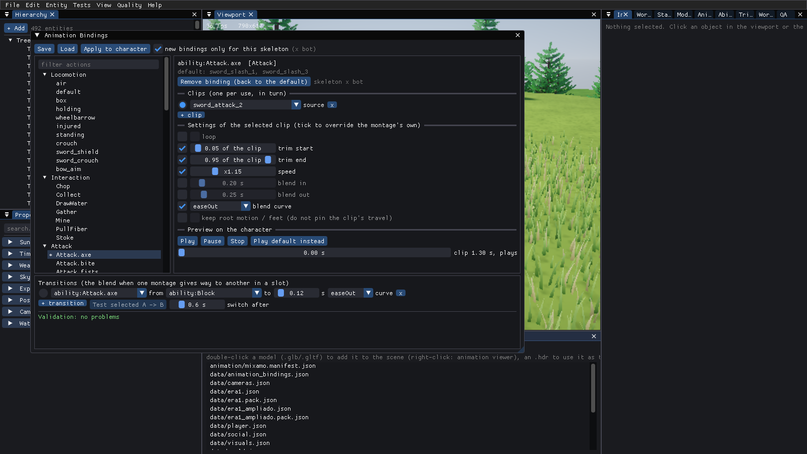

# Editor de animaciones (Animation Bindings)

Una ventana del Editor para decidir **qué clip hace cada acción del juego y cómo se reproduce**, sin tocar C++ ni recompilar: locomoción,
interacción con nodos, ataques, bloqueo, daño recibido, muerte, dormir... con bucle, recorte, velocidad, mezcla y transiciones. Lo guardado se
lee del JSON `assets/data/animation_bindings.json`; sin el fichero (o para una acción que no menciona) el juego reproduce lo de siempre.

## Cómo está hoy el juego (lo que se encontró)

La asignación acción → clip **ya era un dato** en una parte, y esa es la que se aprovecha:

| Pieza | Dónde | Qué decide |
|---|---|---|
| `AnimManifest` | `Animation/AnimManifest.*`, `assets/animation/mixamo.manifest.json` | sets de locomoción (`free`, `sets`), giros, clip de salto (`air`), **montajes** (`MontageDesc`: clip, slot, blendIn/Out, playRate, loop, holdEnd, stripTravel, notifies), **`abilities`** (habilidad → montajes en turno), **`activities`** (trabajo de la tribu → montajes, set, `loop`) |
| `ApplyManifestAbilities` | `Gameplay/AbilitySystemComponent.cpp` | pisa `AbilityDef::Montages` con los del manifiesto (solo los que el personaje puede reproducir) al construir el animador (`Actor::BuildAnimator`, `SetAbilities`) |
| `TribeVisuals` | `Game/TribeVisuals.cpp` | reproduce el montaje de `activities` cuando el miembro está quieto haciendo su trabajo |
| Reglas de combate | `Gameplay/Combat.cpp` (`DefaultCombatRules`, `RegisterCombat`) | los `Attack.<arma>`, `Block` y `Stagger` (daño recibido) llevan los nombres de montaje **escritos en C++** (`sword_attack_1`...). No están en el manifiesto: es lo que la capa nueva destapa |
| `MontagePlayer` | `Animation/Montage.*` | reproduce montajes por slot; al sustituir uno por otro en el mismo slot, mezcla con el `BlendOut` del viejo y el `BlendIn` del nuevo |
| Panel `Timeline` | `Editor/src/EditorAnimPanels.cpp` | edita **un montaje** (blends, rate, loop, notifies, secciones) y lo previsualiza; no sabe de acciones ni de recorte |

Lo que faltaba: recorte del clip, curva de mezcla, transiciones A→B propias, guardar *qué acción usa qué clip* aparte del manifiesto (que es del
pack), los clips de combate/bloqueo/daño como dato, validación, y una ventana para todo esto.

## Modelo de datos

`GB/Animation/AnimBindings.h` (motor, sin ventana). El fichero es una **capa encima del manifiesto**:

```json
{
  "version": 1,
  "bindings": [
    { "action": "ability:Chop",        "clips": [ { "source": "chop_1", "speed": 1.1, "trimStart": 0.05, "trimEnd": 0.9 } ] },
    { "action": "ability:Attack.axe",  "skeleton": "x bot", "clips": [ { "source": "sword_slash_1" }, { "source": "sword_slash_3", "blendIn": 0.1 } ] },
    { "action": "activity:sleep",      "clips": [ { "source": "act_lie_down", "loop": false } ], "set": "free" },
    { "action": "loco:default",        "clips": [ { "source": "walking (2)", "replaces": "walking" } ] },
    { "action": "air",                 "clips": [ { "source": "jump" } ] }
  ],
  "transitions": [ { "from": "ability:Attack.axe", "to": "ability:Block", "duration": 0.12, "curve": "easeOut" } ]
}
```

* **Acción** (`action`): `ability:<nombre>` (Chop, Mine, Gather, `Attack.axe`, Block, Stagger = daño recibido...), `activity:<trabajo>`
  (sleep, dead, eat, farm.till, talk.chat...), `loco:<set>` (default, crouch, injured... cada clip sustituye a uno del set con `replaces`) y `air`
  (salto/caída).
* **Esqueleto** (`skeleton`): vacío = todos los modelos; si no, la clave del modelo (`SkeletonKey`: nombre del fichero sin carpeta ni extensión, en
  minúsculas). El del esqueleto gana al general.
* **Contexto** (`when`): `{ "node": "tree", "tool": "axe" }`. `ResolveClip` solo elige el binding si todo el contexto coincide y gana el más
  específico. Hoy el juego elige el clip por habilidad (Chop/Mine/Gather ya son "por tipo de nodo y herramienta"), así que `when` solo lo usa quien
  pase contexto a `ResolveClip`; el aplicado al manifiesto ignora los bindings con `when`.
* **Clip** (`clips[]`, en turno, uno por uso): `source` es un **montaje del manifiesto** (hereda slot, notificaciones, secciones, `holdEnd`) o,
  si no existe, un **clip del modelo** (se crea el montaje). Todo lo demás es un *override* opcional: `loop`, `trimStart`/`trimEnd` (fracción del
  clip), `speed`, `blendIn`/`blendOut` (s), `curve` (`linear`, `smooth`, `easeIn`, `easeOut`), `keepRootMotion` (no fijar el recorrido del clip al
  controlador: `stripTravel = false`).
* **Transición** (`transitions[]`): al sustituir `from` por `to` en un slot, mezcla durante `duration` con `curve`. Los extremos son acciones
  (se expanden a sus montajes), nombres de montaje o `*`.

### Capa de resolución

`ResolveClip(bindings, manifest, defaults, action, context, skeleton, turn, hasClip) -> ResolvedClip {clip, loop, trim, speed, blend, curve, ...}`.
Si no hay binding, o su clip no existe, responde el **valor por defecto** (el manifiesto o la lista de C++ de `BindingDefaults`) y dice por qué
en `Why`. `ApplyBindings(manifest, ...)` usa esa misma resolución para reescribir `abilities`, `activities`, `sets`, `air` y `transitions` del
manifiesto; los montajes con overrides se guardan como alias `bind:<acción>#<n>`. A partir de ahí el juego hace lo de siempre
(`ApplyManifestAbilities`, `TribeVisuals`, `ApplyManifest`): **no hay otro camino**, y sin bindings el manifiesto sale idéntico.

Cambios en el reproductor (`MontageDesc`): `TrimStart`/`TrimEnd` (el reloj empieza, acaba y hace bucle dentro del recorte; las notificaciones
siguen siendo fracción del clip entero), `Curve` (forma del peso en la mezcla) y `MontagePlayer::SetTransitions`. Los valores por defecto
reproducen el comportamiento anterior byte a byte (los campos nuevos no se escriben en el JSON si son los de por defecto).

### Validación

`ValidateBindings` (también en el panel y en el log): clips o montajes inexistentes, acción que el juego no tiene, recorte fuera de 0..1 o
invertido, velocidad no positiva, mezcla negativa, **bucle en una habilidad de un solo disparo** (o `holdEnd`), locomoción que sustituye un clip
que el set no tiene, y transiciones cuyos extremos no reproducen nada (**sin salida**), de un extremo a sí mismo o repetidas.
`ApplyBindings` registra además cada entrada que ignora (`Animation bindings: ...` en el log) y deja el valor por defecto.

## Ventana "Animation Bindings"

Menú *View > Animation Bindings* (o `panel AnimBindings`). Lista de acciones por categoría (Locomotion, Interaction, Attack, Defence, Life, Work,
Social), con su clip actual; al elegir una se edita su binding (clip, bucle, recorte, velocidad, mezcla, curva, mantener root motion), se
previsualiza sobre el personaje del jugador (Play/Pause/scrub, la reproducción respeta el recorte) y se prueba una transición A→B. Guardar/Cargar
escriben `animation_bindings.json`; la lista de problemas está siempre visible.
La lógica vive en el motor; el Editor solo la dibuja.



(Captura headless: `Attack.axe` ligado a otro montaje con velocidad, recorte y curva; la lista de la izquierda muestra también los `Attack.*` de C++.)

## Cómo usarlo (pasos para reproducirlo)

1. Arranca el Editor y un personaje con animaciones (el X Bot de `packs/full`, ver [modelos-y-animacion.md](modelos-y-animacion.md)):
   `generate temperate 5` y `player "packs/full/X Bot.fbx"`.
2. Abre la ventana: menú **View > Animation Bindings** o `panel AnimBindings on`.
3. Elige una acción a la izquierda (por ejemplo `Interaction > Chop`; un `*` marca las que ya tienen binding). Pulsa **Bind this action**: empieza copiando lo
   que el juego reproduce hoy. Cambia el *source* (un montaje o cualquier clip del modelo), marca la casilla de un ajuste para sobrescribirlo
   (loop, trim, speed, blend, curva, root motion) y usa **Play / Pause / el deslizador** para ver el resultado sobre el personaje.
   **Play default instead** reproduce lo de antes para comparar.
4. **Transiciones**: `+ transition`, elige *from* y *to* (acciones, montajes o `*`), duración y curva, selecciónala y pulsa **Test selected A -> B**: reproduce A y
   cambia a B tras *switch after* segundos usando esa mezcla.
5. La lista de abajo valida en vivo (y escribe los avisos en la consola/log al cambiar). **Save** escribe `assets/data/animation_bindings.json`;
   **Apply to character** reconstruye el personaje controlado con los bindings sin reiniciar; los personajes nuevos ya salen con ellos.
6. Lo mismo por consola/script: `bindings_set ability:Chop chop_2 speed=1.2 trim=0.05,0.9 curve=easeOut`, `bindings_transition ability:Chop * 0.15 linear`,
   `bindings_validate`, `bindings_resolve ability:Attack.axe 1`, `bindings_save`, `bindings_load`, `bindings_apply`.
7. Captura headless del panel: `Editor --hidden --quality=low "--exec=generate temperate 5; player \"packs/full/X Bot.fbx\"; panel AnimBindings on; bindings_set ability:Chop chop_2 speed=1.2; wait 30; shot_ui bindings.png; quit"`.

Tests: `GBAnimBindingsTests` (`ctest -R anim_bindings`, sin ventana): JSON, validación, resolución con fallback, el manifiesto con y sin bindings, recorte/bucle/velocidad/curvas/transiciones
sobre el reloj de animación.

## Qué no cubre

* La locomoción (idle/walk/run) se sustituye clip a clip, pero su velocidad y mezcla las manda el blend space por velocidad medida: no se editan.
* Bindings por contexto (`when`) no tienen todavía quien pase el contexto en el juego.
* `RegisterCombatContent` (al cambiar las reglas de combate) vuelve a poner los montajes `Attack.*` de C++: hay que volver a aplicar los bindings (`bindings_apply`).
* `TribeVisuals` calcula la fracción de la animación con la duración del clip entero (`Duration`, que no cambia con el recorte): con un recorte, los props
  que dependen de esa fracción siguen el reloj del clip y no el del tramo.
* La velocidad de montaje que pone `TribeVisuals` por edad se multiplica encima, como siempre.
