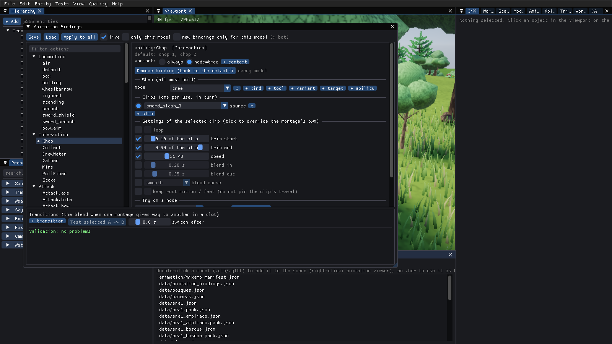
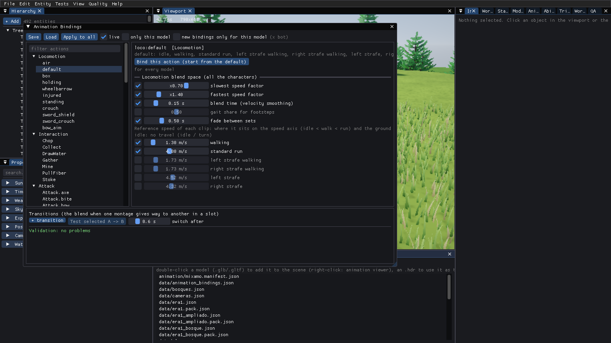

# Editor de animaciones (Animation Bindings)

Una ventana del Editor para decidir **qué clip hace cada acción del juego y cómo se reproduce**, sin tocar C++ ni recompilar: locomoción,
interacción con nodos, ataques, bloqueo, daño recibido, muerte, dormir... con bucle, recorte, velocidad, mezcla y transiciones. Lo guardado se
lee del JSON `assets/data/animation_bindings.json`; sin el fichero (o para una acción que no menciona) el juego reproduce lo de siempre.

## Cómo está hoy el juego (lo que se encontró)

La asignación acción → clip **ya era un dato** en una parte, y esa es la que se aprovecha:

| Pieza | Dónde | Qué decide |
|---|---|---|
| `AnimManifest` | `Animation/AnimManifest.*`, `assets/animation/mixamo.manifest.json` | sets de locomoción (`free`, `sets`), giros, clip de salto (`air`), **montajes** (`MontageDesc`: clip, slot, blendIn/Out, playRate, loop, holdEnd, stripTravel, notifies), **`abilities`** (habilidad → montajes en turno), **`activities`** (trabajo de la tribu → montajes, set, `loop`) |
| `ApplyManifestAbilities` | `Gameplay/AbilitySystemComponent.cpp` | pisa `AbilityDef::Montages` con los del manifiesto (solo los que el personaje puede reproducir) al construir el animador (`Actor::BuildAnimator`, `SetAbilities`) |
| `TribeVisuals` | `Game/TribeVisuals.cpp` | reproduce el montaje de `activities` cuando el miembro está quieto haciendo su trabajo |
| Reglas de combate | `Gameplay/Combat.cpp` (`DefaultCombatRules`, `RegisterCombat`) | los `Attack.<arma>`, `Block` y `Stagger` (daño recibido) llevan los nombres de montaje **escritos en C++** (`sword_attack_1`...). No están en el manifiesto: es lo que la capa nueva destapa |
| `MontagePlayer` | `Animation/Montage.*` | reproduce montajes por slot; al sustituir uno por otro en el mismo slot, mezcla con el `BlendOut` del viejo y el `BlendIn` del nuevo |
| Panel `Timeline` | `Editor/src/EditorAnimPanels.cpp` | edita **un montaje** (blends, rate, loop, notifies, secciones) y lo previsualiza; no sabe de acciones ni de recorte |

Lo que faltaba: recorte del clip, curva de mezcla, transiciones A→B propias, guardar *qué acción usa qué clip* aparte del manifiesto (que es del
pack), los clips de combate/bloqueo/daño como dato, validación, y una ventana para todo esto.

## Modelo de datos

`GB/Animation/AnimBindings.h` (motor, sin ventana). El fichero es una **capa encima del manifiesto**:

```json
{
  "version": 1,
  "bindings": [
    { "action": "ability:Chop",        "clips": [ { "source": "chop_1", "speed": 1.1, "trimStart": 0.05, "trimEnd": 0.9 } ] },
    { "action": "ability:Attack.axe",  "skeleton": "x bot", "clips": [ { "source": "sword_slash_1" }, { "source": "sword_slash_3", "blendIn": 0.1 } ] },
    { "action": "activity:sleep",      "clips": [ { "source": "act_lie_down", "loop": false } ], "set": "free" },
    { "action": "loco:default",        "clips": [ { "source": "walking (2)", "replaces": "walking" } ] },
    { "action": "air",                 "clips": [ { "source": "jump" } ] }
  ],
  "transitions": [ { "from": "ability:Attack.axe", "to": "ability:Block", "duration": 0.12, "curve": "easeOut" } ]
}
```

* **Acción** (`action`): `ability:<nombre>` (Chop, Mine, Gather, `Attack.axe`, Block, Stagger = daño recibido...), `activity:<trabajo>`
  (sleep, dead, eat, farm.till, talk.chat...), `loco:<set>` (default, crouch, injured... cada clip sustituye a uno del set con `replaces`) y `air`
  (salto/caída).
* **Esqueleto** (`skeleton`): vacío = todos los modelos; si no, la clave del modelo (`SkeletonKey`: nombre del fichero sin carpeta ni extensión, en
  minúsculas). El del esqueleto gana al general.
* **Contexto** (`when`): `{ "node": "tree", "tool": "axe" }`. Solo se elige el binding si **todo** el contexto coincide y gana el más específico
  (el de un esqueleto gana al general); el que no tiene `when` es el de reserva. Lo rellena el juego en cada uso de una habilidad
  (`BindingContext`, en `AnimBindings.h`): `ability` (su nombre), `target` (la entidad trabajada), `node` (tipo de nodo: `tree`, `rock`,
  `berry_bush`...), `kind` (su recurso: `wood`, `stone`, `plant`, `loose`), `tool` (familia de la herramienta que pide la habilidad: `axe`,
  `pickaxe`... o `none`) y `variant` (esa herramienta tal como la lleva el personaje: `basic` para el hacha de piedra, `flint`...).
  Las actividades de la tribu (`activity:`) aceptan `when` en el fichero, pero el juego solo les pasa contexto a las habilidades.
* **Clip** (`clips[]`, en turno, uno por uso): `source` es un **montaje del manifiesto** (hereda slot, notificaciones, secciones, `holdEnd`) o,
  si no existe, un **clip del modelo** (se crea el montaje). Todo lo demás es un *override* opcional: `loop`, `trimStart`/`trimEnd` (fracción del
  clip), `speed`, `blendIn`/`blendOut` (s), `curve` (`linear`, `smooth`, `easeIn`, `easeOut`), `keepRootMotion` (no fijar el recorrido del clip al
  controlador: `stripTravel = false`).
* **Transición** (`transitions[]`): al sustituir `from` por `to` en un slot, mezcla durante `duration` con `curve`. Los extremos son acciones
  (se expanden a sus montajes), nombres de montaje o `*`.

### Capa de resolución

`ResolveClip(bindings, manifest, defaults, action, context, skeleton, turn, hasClip) -> ResolvedClip {clip, loop, trim, speed, blend, curve, ...}`.
Si no hay binding, o su clip no existe, responde el **valor por defecto** (el manifiesto o la lista de C++ de `BindingDefaults`) y dice por qué
en `Why`. `ApplyBindings(manifest, ...)` usa esa misma resolución para reescribir `abilities`, `activities`, `sets`, `air` y `transitions` del
manifiesto; los montajes con overrides se guardan como alias `bind:<acción>#<n>`, y los de un binding con `when`, `bind:<acción>?node=tree#<n>`
(el montaje existe en el personaje; lo que cambia es cuál se elige en cada uso). A partir de ahí el juego hace lo de siempre
(`ApplyManifestAbilities`, `TribeVisuals`, `ApplyManifest`) y, para el contexto, `AbilityRuntime::PickMontage` -> `Actor::PickMontage` -> el mismo
`ResolveClip`: **no hay otro camino**, y sin bindings el manifiesto sale idéntico.

Cambios en el reproductor (`MontageDesc`): `TrimStart`/`TrimEnd` (el reloj empieza, acaba y hace bucle dentro del recorte; las notificaciones
propias del montaje siguen siendo fracción del clip entero), `Curve` (forma del peso en la mezcla) y `MontagePlayer::SetTransitions`. Los valores por
defecto reproducen el comportamiento anterior byte a byte (los campos nuevos no se escriben en el JSON si son los de por defecto).

### Recortes y lo que va atado a la fracción de la animación

* `MontagePlayer::RunFraction(montaje)` es el **reloj del tramo**: 0..1 de la parte que se reproduce (sin recorte coincide con el reloj del clip).
  `TribeVisuals` lo usa para la ventana en que las manos alcanzan el nodo (`ReachRule.From/To`), también en los montajes que los bindings crean por
  contexto: con un recorte la ventana sigue lo que se ve, no el clip entero.
* Las notificaciones por defecto de las habilidades (`hit`, `chop`, `mine`...: `AbilityDef::Events`) se interpretan como fracción **del tramo**:
  `AbilityMontages` las coloca dentro del recorte del montaje (con recorte 0.5..1 un `hit` a 0.5 queda en 0.75 del clip). Un montaje que ya tiene
  su propia notificación la conserva.
* Al crear el alias de un binding con otro recorte, las notificaciones del montaje base que quedarían fuera se proyectan proporcionalmente dentro
  del nuevo recorte (`ToMontage`), y el validador lo avisa (`falls outside the trim: it is moved inside it`) porque el momento del golpe cambia.

### Locomoción (blend space)

`locomotion` en el fichero (una lista de entradas, general o por `skeleton`; las del modelo pisan campo a campo a las generales):

```json
"locomotion": [ { "minSpeedScale": 0.7, "maxSpeedScale": 1.4, "velocitySmoothing": 0.15, "minGaitWeight": 0.5, "setFade": 0.35,
                  "clips": [ { "set": "", "clip": "walking", "speed": 1.4 }, { "set": "", "clip": "running", "speed": 4.2 } ] } ]
```

* `clips[].speed` es la **velocidad de referencia** de un clip (m/s): el sitio del clip en el eje de velocidad (idle < walk < run: dónde empieza a
  mezclar el idle con el andar y el andar con el correr) y la velocidad del suelo a la que se reproduce a su ritmo natural. `set` vacío = el set
  por defecto. Un clip sin recorrido (idle, giros) no tiene velocidad que fijar. Qué clip va en cada tramo lo dice el binding `loco:<set>` (`replaces`).
* `velocitySmoothing` es el tiempo con que la mezcla sigue a la velocidad (la mezcla idle-walk-run); `minSpeedScale`/`maxSpeedScale` limitan cuánto se
  acelera o frena un clip para no patinar; `minGaitWeight` es la parte de pasos que hace falta para sonar un paso; `setFade` impone el tiempo de
  cualquier cambio de set (agacharse, cargar caja...; un cambio instantáneo sigue siéndolo).
* Se escribe en `AnimManifest::Locomotion` (clave `locomotion` del manifiesto, solo si hay) y `ApplyManifest` lo aplica a todos los sets del
  personaje (`AnimInstance::SetOptions`, `SetClipSpeed`, `SetFadeOverride`). Vale para todos los personajes con animador de mezcla (los de FBX); el
  zorro y el CesiumMan sin set de locomoción usan el interruptor simple idle/walk/run de `CharacterAnimation`, que no se toca.

### Todos los personajes, y cuando las reglas se recargan

* `ActorWorld::SetBindings(BindingsSetup)` entrega los bindings (con sus valores por defecto y, si se quiere, `Only`: un solo modelo) a **todos** los
  actores del mundo (jugador, IA, otros clanes) y a los que se creen o carguen después. Cada actor calcula su manifiesto (base + los bindings de
  su esqueleto) y solo reconstruye su animador si ese manifiesto cambió.
* La biblioteca de habilidades es compartida y varios modelos pueden tener bindings distintos, así que cada actor elige el montaje de **cada uso**
  con sus propios bindings (`PickMontage`); lo que se escribe en la biblioteca (`ApplyManifestAbilities`) es solo el valor de reserva.
* `GameplayLibrary::Revision()` sube con cada `AddAbility`. Si cambia por fuera (las reglas de combate registran de nuevo los `Attack.*`),
  `ActorWorld::PrepareAbilities` hace que los actores repongan los montajes de sus bindings sin pulsar nada. `Attack.sword` y `Attack.bow` (y
  cualquier arma de las reglas) salen en la lista de acciones con sus montajes de C++.

### Validación

`ValidateBindings` (también en el panel y en el log): clips o montajes inexistentes, acción que el juego no tiene, recorte fuera de 0..1 o
invertido, velocidad no positiva, mezcla negativa, **bucle en una habilidad de un solo disparo** (o `holdEnd`), locomoción que sustituye un clip
que el set no tiene, y transiciones cuyos extremos no reproducen nada (**sin salida**), de un extremo a sí mismo o repetidas.
`ApplyBindings` registra además cada entrada que ignora (`Animation bindings: ...` en el log) y deja el valor por defecto.

## Ventana "Animation Bindings"

Menú *View > Animation Bindings* (o `panel AnimBindings`). Lista de acciones por categoría (Locomotion, Interaction, Attack, Defence, Life, Work,
Social), con su clip actual; al elegir una se edita su binding (clip, bucle, recorte, velocidad, mezcla, curva, mantener root motion), se
previsualiza sobre el personaje del jugador (Play/Pause/scrub, la reproducción respeta el recorte) y se prueba una transición A→B. Guardar/Cargar
escriben `animation_bindings.json`; la lista de problemas está siempre visible.

* **Apply to all** (por defecto, y en vivo con *live*: al terminar una edición, sin arrastrar un deslizador) aplica los bindings a todos los
  personajes del mundo y a los que se creen después; *only this model* lo limita a los del modelo del personaje controlado. Los bindings nuevos
  valen para todos los modelos salvo que se marque *new bindings only for this model*.
* **Variantes por contexto** (acciones `ability:`/`activity:`): `variant: always | node=tree ...` y **+ context** crean otro clip para cuando la
  acción ocurre en un nodo, con una herramienta... (`node`, `kind`, `tool`, `variant`, `target`); cada condición se elige de una lista y se
  quita con `x`.
* **Try on a node** (acciones `ability:`): coloca al personaje controlado delante del nodo más cercano del tipo elegido (le da la herramienta que
  pide) y le hace usar la habilidad: se ve el clip real que eligen los bindings, con sus props.
* **Locomotion blend space** (acciones `loco:`): límites del factor de velocidad, tiempo de mezcla, paso mínimo para los pasos, fundido entre sets y
  la velocidad de referencia de cada clip del set (casilla = sobrescribe la medida del propio clip).
La lógica vive en el motor; el Editor solo la dibuja.


(Captura headless: `Attack.axe` ligado a otro montaje con velocidad, recorte y curva; la lista de la izquierda muestra también los `Attack.*` de C++.)

Variante por contexto (`Chop` con otro clip, recorte y velocidad cuando el nodo es un árbol) y el botón **Try on a node** debajo; `bindings_try tree` hizo que el
personaje talara un árbol del mundo con ese clip:



Afinado de la locomoción (blend space) para todos los personajes: factores de velocidad, tiempo de mezcla, fundido entre sets y velocidad de referencia de cada clip:



(`generate temperate 5; resources world; player "packs/full/X Bot.fbx"; panel AnimBindings on; bindings_when ability:Chop sword_slash_3 node=tree speed=1.4 trim=0.1,0.9; bindings_apply; bindings_try tree; wait 90; shot_ui ctx.png` y
`bindings_loco min=0.7 max=1.4 smooth=0.15 fade=0.5 clip=walking:1.3 "clip=standard run:4.0"; bindings_apply; shot_ui loco.png`.)

## Cómo usarlo (pasos para reproducirlo)

1. Arranca el Editor y un personaje con animaciones (el X Bot de `packs/full`, ver [modelos-y-animacion.md](modelos-y-animacion.md)):
   `generate temperate 5` y `player "packs/full/X Bot.fbx"`.
2. Abre la ventana: menú **View > Animation Bindings** o `panel AnimBindings on`.
3. Elige una acción a la izquierda (por ejemplo `Interaction > Chop`; un `*` marca las que ya tienen binding). Pulsa **Bind this action**: empieza copiando lo
   que el juego reproduce hoy. Cambia el *source* (un montaje o cualquier clip del modelo), marca la casilla de un ajuste para sobrescribirlo
   (loop, trim, speed, blend, curva, root motion) y usa **Play / Pause / el deslizador** para ver el resultado sobre el personaje.
   **Play default instead** reproduce lo de antes para comparar.
4. **Transiciones**: `+ transition`, elige *from* y *to* (acciones, montajes o `*`), duración y curva, selecciónala y pulsa **Test selected A -> B**: reproduce A y
   cambia a B tras *switch after* segundos usando esa mezcla.
5. La lista de abajo valida en vivo (y escribe los avisos en la consola/log al cambiar). **Save** escribe `assets/data/animation_bindings.json`;
   **Apply to all** reconstruye todos los personajes del mundo con los bindings sin reiniciar (y *live* lo hace solo al acabar cada edición); los nuevos
   ya salen con ellos.
6. Lo mismo por consola/script: `bindings_set ability:Chop chop_2 speed=1.2 trim=0.05,0.9 curve=easeOut`, `bindings_transition ability:Chop * 0.15 linear`,
   `bindings_validate`, `bindings_resolve ability:Attack.axe 1`, `bindings_save`, `bindings_load`, `bindings_apply [model]`; por contexto,
   `bindings_when ability:Chop chop_2 node=tree,tool=axe speed=1.2`; probar en un nodo, `bindings_try tree`; locomoción,
   `bindings_loco min=0.7 smooth=0.15 clip=walking:1.4` (`bindings_loco reset` la quita).
7. Captura headless del panel: `Editor --hidden --quality=low "--exec=generate temperate 5; player \"packs/full/X Bot.fbx\"; panel AnimBindings on; bindings_set ability:Chop chop_2 speed=1.2; wait 30; shot_ui bindings.png; quit"`.

Tests (sin ventana): `GBAnimBindingsTests` (`ctest -R anim_bindings`): JSON, validación, resolución con fallback, el manifiesto con y sin bindings,
recorte/bucle/velocidad/curvas/transiciones sobre el reloj de animación, `RunFraction`, las notificaciones dentro del recorte y la locomoción en el
fichero y el manifiesto. `GBAnimBindingsWorldTests` (`ctest -R anim_bindings_world`): el contexto de un uso, los bindings en todos los personajes (los que
hay, los nuevos, un solo modelo, quitarlos), la elección por nodo, la recarga de las reglas con `Attack.sword` y `Attack.bow`, y la locomoción afinada
en todos los personajes.

## Qué no cubre

* Las actividades de la tribu (`activity:`) aceptan `when` en el fichero, pero `TribeVisuals` no les pasa contexto: solo las habilidades (Chop, Mine,
  Gather, ataques...) eligen su clip por nodo y herramienta.
* La locomoción afina el blend space por velocidad medida (referencias de velocidad, límites, tiempos); no hay umbrales idle/walk/run discretos
  porque el motor mezcla de forma continua. El zorro y el CesiumMan (sin set de locomoción) no se afinan.
* La biblioteca de habilidades sigue siendo una sola: el valor de reserva que escribe `ApplyManifestAbilities` es el del último actor que lo puso; los
  bindings por modelo se eligen por actor en cada uso, pero un `activity:` o la lista de `Montages` de la biblioteca (que lee, por ejemplo, la ventana de
  alcance de las manos) no distinguen modelos.
* Las secciones de un montaje (`sections`) no se reubican al cambiar el recorte; las notificaciones sí.
* La velocidad de montaje que pone `TribeVisuals` por edad se multiplica encima, como siempre.
