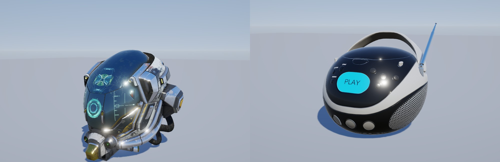
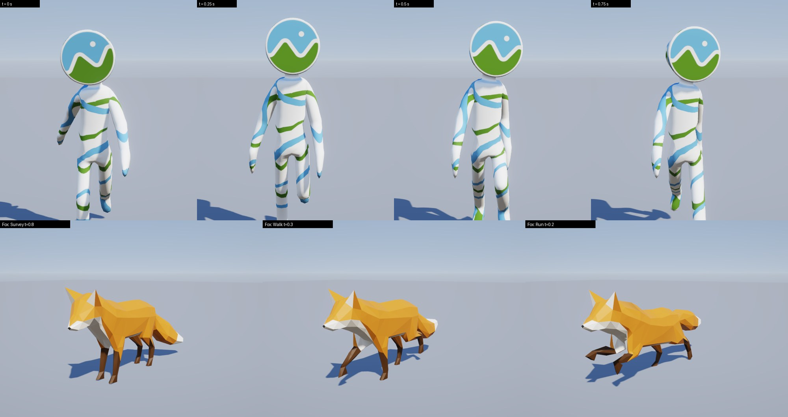

# Modelos, animación y cámaras

Importación glTF y FBX, animación esquelética, análisis de clips y cámaras.

[← Volver al README](../README.md)

## Importación glTF

`GB::Model::Load("modelo.glb")` carga glTF 2.0 (`.glb`/`.gltf`, exportado de Blender: *File > Export > glTF 2.0*) y `model->AddToScene(scene)` lo añade al renderer.

Soportado: mallas (normales/tangentes generadas si faltan), jerarquía de nodos, materiales metálico-rugosidad con texturas (color base, metal/rugosidad, normal, oclusión, emisivo), modos alfa (opaco, máscara, mezcla ordenada), doble cara, `KHR_materials_emissive_strength`, texturas embebidas o externas.
Pendiente: morph targets, luces del archivo, UV distintas de UV0, `KHR_texture_transform`.

`Sandbox --scene=model --model=ruta.glb [--yaw=GRADOS] [--nofloor]` (por defecto el casco de `assets/models`, CC BY 4.0).
Validado con el casco y modelos de prueba de Khronos (BoomBox, AlphaBlendModeTest, NormalTangentMirrorTest) y con un `.glb` generado por `tools/make_test_gltf.py` para el test automático.



## Animación

```cpp
auto model = GB::Model::Load("personaje.glb");          // asset inmutable y compartible
GB::ModelInstance actor(*model);                        // estado de reproducción + pose
actor.Play("Walk");                                     // bucle por defecto, mezcla de 0,2 s
actor.Play("Run", true, 0.3f);                          // cross-fade de 0,3 s desde la animación actual
actor.Update(dt);                                       // cada frame
actor.AddToScene(scene);                                // objetos con la pose actual (skinning en GPU)
```

Animación de nodos y esqueletal (skinning por GPU con SSBO de huesos, también en las sombras), interpolación STEP / LINEAR (slerp) / CUBICSPLINE, bucle o una sola pasada, velocidad, pausa, `SetTime` y mezcla entre clips.
`Sandbox --scene=model --model=x.glb --anim=Walk --time=0.3` (congela ese instante, ideal para capturas); teclas 1-9 cambian de clip y Espacio pausa.
Pendiente: morph targets (blend shapes), máquina de estados / blend trees, retargeting.

### Grabar un clip

```
xvfb-run -a ./build/Sandbox/Sandbox --scene=model --model=Fox.glb --playlist=Survey,Walk,Run --switch=1.2 \
    --orbit=25 --size=960x540 --hidden --frames=96 --fps=24 --record=frames
ffmpeg -framerate 24 -i frames/frame_%05d.png -c:v libx264 -pix_fmt yuv420p clip.mp4
```
`--record=DIR` guarda un PNG por frame con paso de tiempo fijo (1/fps), así el resultado es determinista aunque el render sea lento.



## Cámaras

`GB::Camera`: perspectiva u ortográfica, `Camera::Blend(a, b, t)` para transiciones. Controladores (usables por código o por entrada):
- `OrbitController`: órbita alrededor de un punto (ratón: izq. rota, der./centro desplaza, rueda zoom; flechas/WASD, Q/E, stick derecho).
- `FlyController`: vuelo libre (WASD + Q/E, Shift acelera, botón derecho mira, rueda cambia la velocidad, sticks del mando).
- `FollowController`: cámara de seguimiento en tercera persona con suavizado independiente de los fps.
- Cámaras del glTF (p. ej. las de Blender, perspectiva u ortográficas, **animadas con el archivo**): `model->GetCameras()` y `instance.GetCamera(i, camera)`.

Sandbox: `C` (o botón Y del mando) recorre órbita / vuelo / cámaras del archivo con transición suave; `--camera=orbit|fly|N`.
`tools/add_camera_rig.py in.glb out.glb` añade a un modelo una plataforma de cámaras de demostración (giro 360°, travelling, cenital ortográfica).

## FBX y análisis de clips

`Model::Load` abre también `.fbx` (ufbx v0.9.0 fijada por FetchContent): malla, esqueleto, skin (4 influencias por vértice), materiales y animaciones, convertidos a **metros, Y arriba, mano derecha** (un FBX en centímetros como los de Mixamo se importa a escala real). Las animaciones se hornean a 30 fps por hueso; un archivo con una sola toma da su nombre al clip (`walking.fbx` → clip `walking`) y las tomas de un fotograma (la T-pose de Mixamo) se descartan.

- `Model::AppendAnimations(archivo.fbx)`: añade los clips de otro FBX (p. ej. un clip de Mixamo sin malla) emparejando los huesos por nombre; informa de los huesos que el modelo no tiene.
- `AnalyzeClip(model, clip)` (`GB/Animation/ClipAnalysis.h`): mide el movimiento de la raíz (desplazamiento, velocidad m/s, giro), la altura de la cadera, la calidad del bucle (grados por hueso entre la primera y la última pose), los apoyos de cada pie (tiempos normalizados), la longitud del ciclo de paso y la fase de vuelo de los saltos. Son los datos que necesitan los blend trees, el root motion y el audio de pasos.
- Editor: `load <modelo.fbx>`, `anims <archivo.fbx|carpeta>`, `clips`, `play <clip> [fundido]` y `anim_stats [clip|all]`.
- Test `fbx` (CPU, sin GL) con ficheros ASCII pequeños generados por `tools/make_test_fbx.py`; con `GB_MIXAMO_DIR=<carpeta del pack>` comprueba además el pack real (no está en el repositorio).

Medido en el pack Mixamo *Male Locomotion*: caminar 1,03 s a 1,67 m/s (ciclo de 1,72 m), correr 0,73 s a 4,42 m/s (3,24 m), strafes andando 1,73 m/s y corriendo 4,3–4,5 m/s, giros de 90° en sitio (≈0,93 s), salto de 2,17 s con 21 % de vuelo, idle de 8,33 s en bucle. Los clips llevan el movimiento en el hueso `Hips` (root motion), así que mezclar caminar y correr exige escalar la reproducción y sincronizar los pies. El estudio completo y el plan de locomoción están en `docs/ANIMACION_LOCOMOCION.md`.

## Mezcla de poses y locomoción

`GB/Animation/` (CPU, sin GL):

- `Pose`: una `BonePose` por hueso; `SampleClip`, `BlendPoses` (rotaciones por el camino corto), `BlendPosesMasked` y `MakeBoneMask` (máscaras por hueso, p. ej. tronco y brazos). `ModelInstance::SetPose` aplica una pose calculada fuera (animador, blend tree) y deja de reproducir clips propios.
- `BlendSpace`: clips colocados en un plano (1D o 2D). Los pesos son exactos en cada clip y lineales entre ellos (triangulación de Delaunay de las posiciones, sin triángulos degenerados); fuera de los clips se usa el punto más cercano, así que nunca se mezcla hacia una velocidad que ningún clip cubre.
- `LocomotionBlender`: andar/correr/strafe a partir de clips colocados por su **velocidad de raíz medida** (`MakeGaitInfo`). Una fase de ciclo compartida alineada con el apoyo del pie izquierdo (los pies no se cruzan al mezclar), velocidad de reproducción escalada a la velocidad pedida (sin patinaje entre las velocidades propias de los clips, limitada a 0,6–1,5x), movimiento de raíz eliminado (manda el controlador) y **eventos de apoyo** `FootEvent` (izquierdo/derecho) cuando el ciclo cruza un apoyo.
- `FootstepSounds` (`GB/Audio/`): reproduce el paso de la superficie bajo el pie (hierba, tierra, piedra, arena, madera, nieve, agua), con variaciones y posición 3D.
- Editor: `player <personaje.fbx>` (ver más abajo), `audio_record <wav>` / `audio_stop` para grabar el audio en ejecuciones headless (el editor mezcla al ritmo de la simulación). La superficie sale del bioma del mundo.
- Test `locomotion` (CPU) con el rig generado (`idle`, andar 1,2 m/s y correr 3 m/s con pies que de verdad se apoyan); con `GB_MIXAMO_DIR` mezcla también el pack Mixamo real.

### Personaje con locomoción mezclada (Fase 11A-3)

El controlador de tercera persona del prototipo (`CharacterController`, `ThirdPersonCamera`, `PlayerMode`) se reutiliza tal cual; esta fase solo añade la capa que lo une con la mezcla de locomoción, sin duplicar movimiento ni cámara:

- `MotionState` + `MotionTracker` (`GB/Game/MotionState.h`): el estado de movimiento que necesita la animación (velocidad en ejes del personaje, aceleración, giro, agua), derivado del controlador después de cada paso. La animación solo lee esto: no sabe quién movió al personaje.
- `AIDriver` (`GB/Game/AIDriver.h`): un NPC es el mismo controlador con el mismo `CharacterInput` que generarían las teclas (`AIDriver::InputFor`), llevado por una ruta con frenado de llegada y detección de atasco.
- `CharacterAnimator` (`GB/Animation/`): `LocomotionBlender` + pasos (`FootstepSounds`) a partir del `MotionState`. `PlayerMode` lo usa cuando el personaje es un FBX con clips de locomoción (el `idle`/`walk`/`run` por umbrales queda para los modelos glTF sin ese conjunto, como el zorro).
- Editor: `player "<carpeta>/X Bot.fbx"` carga el personaje y las animaciones FBX de su carpeta y camina con la mezcla; `player_goto <x> <z> [run]` lo lleva una IA. Test `character_layer` (CPU).

### Sets de locomoción y overlays (Fase 11B-1)

`AnimInstance` (`GB/Animation/AnimInstance.h`) es el estado de animación de un personaje: varios **sets de locomoción** (cada uno es un `LocomotionBlender` con sus clips colocados por su velocidad medida) de los que uno está activo. Un **overlay** es el cambio de set (libre → llevar una caja → empujar la carretilla): las poses se mezclan con un fundido suave y el set nuevo continúa en la misma fase del paso y con la misma velocidad, así que los pies no se cruzan; si el cambio se interrumpe, el nuevo fundido parte de la pose que se ve (sin saltos) y los pasos no se duplican durante el cambio.

- `LocomotionSetDesc { nombre, clips }`; el set `default` (alias `free`) existe siempre. `MixamoSets()` define `box`, `holding` y `wheelbarrow` con los clips del pack de granja.
- `CharacterAnimator` envuelve un `AnimInstance` (`Anim()`), y `PlayerMode` registra los sets del personaje FBX.
- Editor: `player_overlay` lista los sets y `player_overlay <set> [fundido]` cambia de uno a otro.
- Test `anim_instance` (CPU): registro, cambio andando sin saltos de hueso, interrupción, cambio instantáneo y, con `GB_MIXAMO_DIR` y `GB_FARMING_DIR`, los sets reales.


### Los dos sistemas de animación: qué se conserva de cada uno

| | `CharacterAnimation` (prototipo) | `AnimInstance` / `LocomotionBlender` |
|---|---|---|
| Entrada | velocidad en el suelo (un número) | `MotionState` (velocidad en ejes del personaje, giro, aire) |
| Clips | por nombre (`Survey`/`Walk`/`Run`), valen modelos con 1 clip (CesiumMan) | por velocidad medida, cualquier cantidad, strafes, sets |
| Transición | histéresis idle/walk/run + fundido de 0,25 s | mezcla continua; sin saltos de estado |
| Pies | velocidad de reproducción limitada | fase compartida alineada con el apoyo; escala 0,6–1,5x |
| Pasos | `FootstepTracker`: apoyos detectados por la altura del pie (sirve con cualquier clip) | `FootEvent` de la fase del ciclo (exactos y baratos) |

Decisión: manda `AnimInstance` para los personajes con el conjunto de clips (FBX/Mixamo). `CharacterAnimation` se queda **solo** como respaldo para modelos glTF con uno a tres clips sin análisis posible (zorro, CesiumMan), porque ahí la mezcla continua no tiene qué mezclar. Lo mejor del prototipo que se ha llevado al sistema nuevo: el tipo `FootPlant` (posición, rumbo y velocidad del pie al apoyar). `AnimInstance::Plants()` entrega los eventos de paso con ese mismo tipo, así que huellas, polvo y salpicaduras se alimentan igual con cualquiera de los dos orígenes (`FootstepTracker` o fase del ciclo), sin código duplicado en cada consumidor. `PlayerMode::Plants()` lo expone al editor.

### Salto, montajes y slots (Fase 11B-2)

- **Salto y caída en el controlador** (`CharacterController`): `CharacterInput::Jump` (la pulsación inicia el salto, mantener la tecla no repite), `JumpSpeed`/`Gravity`/`AirControl` en `CharacterConfig`, y caída libre al pisar un borde más de `FallDrop` por encima del suelo. `MotionState` lleva `Grounded`, `VerticalSpeed`, `Landed` y `LandingSpeed` (el aterrizaje suena como paso fuerte). En el editor: Espacio / botón A, o `J` en los guiones de `player` (`player J:0.2,:3`).
- **`AirLayer`**: la pose de salto/caída sigue al vuelo real del controlador, no a un temporizador. Al despegar reproduce el clip hasta su fase de vuelo (`ClipStats::AirStart/AirEnd`) y la mantiene mientras dure el aire; al aterrizar reproduce el resto del clip (amortiguar) mientras se desvanece. Se quita la subida de cadera del clip (ya la pone el controlador) y se conservan las flexiones.
- **`MontagePlayer`** (`GB/Animation/Montage.h`): acciones de una vez sobre la locomoción. Un **slot** es una parte del cuerpo (`FullBody`, o todo lo que cuelga de un hueso, p. ej. `UpperBody` = `mixamorig:Spine`); un montaje solo sustituye los huesos de su slot, así que una acción de brazos puede jugarse mientras las piernas siguen andando. `MontageDesc`: clip, slot, fundidos de entrada/salida, velocidad, bucle, notificaciones por fracción del clip. Un montaje nuevo en el mismo slot fundide al anterior (sin saltos, incluso a mitad de un fundido); `MontageEvent` (`Notify`, `Finished`, `Interrupted`) por fotograma. El desplazamiento horizontal del clip se quita de la raíz (manda el controlador). Con un montaje de cuerpo completo en pantalla se silencian los pasos de la locomoción.
- `AnimInstance::Montages()` / `Air()`; `CharacterAnimator::AddMixamoActions()` registra el slot `UpperBody`, el clip `jump` y las once acciones de granja (`milk_cow`, `dig_plant`, `plant`, `plant_tree`, `pick_fruit` (+2, +3), `pull_plant` (+2), `water`, `wheelbarrow_dump`).
- Editor: `player_montage` lista las acciones, `player_montage <nombre>` la juega y `player_montage stop` la detiene.
- Test `montage` (CPU): el rig generado (registro, fundidos, notificaciones, interrupción, el slot de la parte superior no toca las piernas) y, con `GB_MIXAMO_DIR` y `GB_FARMING_DIR`, las acciones y el salto reales. Test `character_layer`: salto, aterrizaje y caída desde un borde.

Pendiente: parámetros y transiciones por condiciones (giro en sitio, agacharse).

### Sockets, objetos con agarres e IK de manos (Fase 11C-1)

- **`HumanoidRig`** (`GB/Animation/Rig.h`): los huesos de un humanoide (cadera, columna, cabeza, brazos con la base del dedo corazón, piernas) buscados por nombre (`mixamorig:` por defecto); lo que falta queda en -1 y todo lo que lo usa lo salta.
- **`SocketSet` / `StandardSockets`** (`Socket.h`): un socket es un sitio con nombre del esqueleto (hueso + desplazamiento en el espacio del hueso). Se crean desde la pose de reposo, con los ejes del personaje (+Z delante, +X su izquierda), así que valen para cualquier personaje con ese esqueleto: `hand_l`/`hand_r` (centro de la palma), `head`, `back`, `carry` (delante del pecho), `hip_l`/`hip_r`, `foot_l`/`foot_r`.
- **`SolveTwoBoneIK`** (`IK.h`): IK analítico de dos huesos sobre una `Pose` (ley de cosenos): el codo/rodilla se dobla hacia un polo, las longitudes se conservan, un objetivo fuera de alcance deja la cadena estirada hacia él, `weight` mezcla con la pose y se puede pedir la orientación final del extremo (la mano con la del agarre).
- **`Prop` y `GripPoint`** (`AnimInstance.h`): un objeto sigue un socket del cuerpo (`Offset` lo coloca en el marco del socket) y cada agarre lleva una mano a su sitio con IK, después de los clips y montajes y antes de que la pose llegue a la instancia. Las manos lo alcanzan (y lo sueltan) con un fundido; `Attach`, `Detach`, `PropMatrix`, `PropWeight`. `SnapGrips` toma los agarres de donde las palmas están en pantalla (herramienta de autoría: la caja se sujeta exactamente donde los clips ponen las manos). Una caja entre las dos manos se mantiene con los clips de caja, y con otro personaje o una altura distinta el IK corrige el agarre.
- Editor: `player_attach box|bag|tool|off`: la caja pasa al set `box`, mide los agarres y se lleva con las dos manos; la mochila va a la espalda y la herramienta en la mano derecha.
- Tests: `props` (CPU) con un humanoide generado (`tools/make_test_fbx.py` → `tests/data/test_humanoid.fbx`): rig, sockets, IK (alcance, longitudes, polo, estirado, peso, orientación), caja con agarres, `SnapGrips`; con `GB_MIXAMO_DIR`/`GB_FARMING_DIR`, la caja con los clips reales (palmas a menos de 1,5 cm de los agarres caminando). Observación del pack: el clip `box walk arc` tiene un salto propio de unos 18 cm en la mano una vez por ciclo.

### IK de pies y mirada (Fase 11C-2)

Capas procedurales de `AnimInstance`, después de los clips, los montajes y la pose de salto (y antes de los agarres de las manos). Se atenúan solas mientras hay una acción de cuerpo completo o un salto en pantalla.

- **`FootIK`** (`FootIK.h`): con una función de altura del terreno (`Feet().SetGround(f)`), cada pie se mueve la diferencia entre la altura del suelo bajo él y la del suelo bajo el personaje; la pelvis baja hasta el pie más bajo (nunca sube) para que las piernas lleguen; cada pierna se resuelve con IK de dos huesos y la suela se inclina hacia la pendiente (con tope). Los desplazamientos se suavizan (un escalón repentino se asienta en unas décimas de segundo, sin saltos). Los clips siguen decidiendo dónde van los pies sobre el plano.
- **`LookAt`** (`LookAt.h`): gira la cabeza (y un poco el cuello y el pecho) hacia un punto del mundo con límites de giro y cabeceo (70°/40°), suavizado y fundido de entrada y salida; se aplica como corrección de la pose del clip, no la sustituye. Un objetivo a la espalda gira la cabeza solo hasta el límite.
- Editor: el jugador FBX lleva el IK de pies al terreno activado (`player_feet on|off`) y `player_look <x> <y> <z>|camera|off` gira la cabeza.
- Test `procedural` (CPU, humanoide generado): suelo plano sin cambios, escalón arriba y abajo, pendiente (la suela la sigue), personaje colocado, girado y escalado, pesos, escalón repentino, mirada (alcance, cabeceo, límites, volver a mirar al frente, reparto entre pecho, cuello y cabeza) y las dos capas dentro de un `AnimInstance`.

Pendiente: manos y rodillas al suelo en posturas arrodilladas o sentadas, y bloqueo del apoyo (sin patinaje) de los pies.

### Interacciones, motion warping y tareas de NPC (Fase 11D-1)

El mismo flujo para el jugador y para un NPC: ir al punto → alinearse con motion warping → reproducir el montaje → eventos → fin.

- **`InteractableComponent`** (`Entity.h`): lista de puntos de interacción de una entidad: dónde se coloca el personaje (en el espacio de la entidad), hacia dónde mira, el montaje, qué prop debe llevar (`Requires`) y cuál lleva después (`Gives`). Se guardan en los ficheros de escena y se copian al duplicar. Editor: `entity interact <entidad> <punto> <montaje|-> <x> <y> <z> <yaw> [requiere] [da]` (y `entity interact <entidad> clear`), con deshacer; `interact` sin argumentos los lista.
- **`MotionWarp`** (`GB/Game/MotionWarp.h`): lleva al personaje a la posición y orientación exactas en un tiempo corto (suavizado, el giro por el camino corto). Los clips de estación no mueven la raíz, así que el personaje se asienta en el punto mientras el montaje se funde.
- **`InteractionRunner`** (`Interaction.h`): `Approach` (el `AIDriver` produce el mismo `CharacterInput` que las teclas) → `Align` (warp mientras empieza el montaje) → `Act` (se mantiene en su sitio; las notificaciones del montaje salen como `notify:<nombre>`) → `Done` (`gives:<prop>`, `done`). Falla con el motivo si falta el prop requerido, el personaje no tiene el montaje, no llega al punto o la acción se interrumpe. Sin animación o sin montaje, el punto es solo una visita.
- **`TaskRunner` / `ParseTasks`** (`TaskList.h`): lista de tareas de un NPC en texto (`goto x z [run]`, `interact <entidad> [punto]`, `wait s`, `attach prop`, `detach [prop]`, separadas por `;`, `|` o líneas, `#` comenta). Da el input al controlador como lo haría el jugador; qué significa "prop" lo decide el anfitrión (`PropHandler`). Una tarea imposible detiene la lista con el motivo.
- Editor: `interact <entidad> [punto]` y `player_tasks <lista>|stop` (el jugador hace lo que haría un NPC).
- Test `interaction` (CPU): puntos en espacio de mundo, escena y duplicado, warp (exacto, camino corto), el runner (fases, notificación una sola vez, posición y orientación exactas sin teletransporte), **dos personajes** (jugador y NPC con prisa, desde sitios distintos) que acaban en el mismo sitio y orientación, requisitos y fallos, y las listas de tareas (análisis y ejecución).

Pendiente: sistema de conducta más allá de listas lineales (prioridades, necesidades), reservas de puntos de interacción (dos personajes en el mismo punto) y 11D-2 (articulaciones físicas y ragdoll).

### Set `injured` y giros en sitio

- `MixamoSets()` añade el set `injured` (pack *Male Injured*): idle, andar, correr y andar y correr hacia atrás; la mezcla de locomoción los coloca por su velocidad de raíz medida, así que los gestos hacia atrás se activan con velocidad negativa. `player_overlay injured` lo activa.
- `TurnLayer` (`GB/Animation/TurnLayer.h`, expuesta como `AnimInstance::Turn()`): con el personaje casi parado (< 0,4 m/s) y girando (`MotionState::YawRate`), reproduce un clip de giro encima de la locomoción. Del clip se quitan el giro de la cadera y su desplazamiento (el controlador ya gira y mueve al personaje), así que se ven los pies pisando y la torsión de la columna. Qué clip es el izquierdo y cuál el derecho se lee del propio clip (el signo de su giro de raíz). Cada set tiene su pareja: libre (`left/right turn 90`), `box` (`box turn`, `box turn (2)`), `holding` e `injured`.
- `CharacterConfig::TurnInPlaceAngle` (0 = desactivado): desde parado, si la dirección pedida está a más de ese ángulo, el personaje gira primero sobre sí mismo a `TurnInPlaceRate` rad/s y luego echa a andar. `PlayerMode` lo activa (70°) para los personajes con clips de giro.
- Test `turn_layer` (CPU; con `GB_MIXAMO_DIR` y opcionalmente `GB_INJURED_DIR` y `GB_FARMING_DIR` usa los packs reales) y ampliación de `character`.

### Alta automática de personajes y panel de animación (Fase 11E-1)

- **`FindHumanoidRigAuto`** (`Rig.h`): encuentra los huesos de un humanoide sea cual sea su convención de nombres: Mixamo, el maniquí de Unreal, los humanoides de Unity / VRM y 3ds Max Biped; gana la convención con más huesos emparejados. Con eso `AnimInstance` (sockets, IK de manos y pies, mirada) funciona también con esqueletos que no son de Mixamo.
- **`AnalyzeCharacter`** (`Character.h`): la comprobación al importar un personaje. Informa de la convención del esqueleto, los huesos que faltan, el tamaño (desde el esqueleto o la malla; avisa si no está entre 0,5 y 3 m: ¿está en centímetros?), hacia dónde mira (+Z) y si su izquierda está en +X, los sockets que se pueden crear, qué clip hace cada papel (idle, walk, run, strafes, jump, giros; por nombre, sin contar las variantes con caja o carretilla), qué sets de locomoción y montajes de granja permiten sus clips y los avisos. `FormatCharacterProfile` da el informe de texto y `CharacterProfileToJson` el JSON para agentes y diffs. `CharacterProfile::Analysis` lleva los nombres de hueso de ese esqueleto para el análisis de clips y la locomoción; `CharacterAnimator::AddRoleClips` rellena el set libre con los clips de cada papel.
- Editor: `character_check [personaje.fbx]` (sin argumento, el del jugador), `character_export <fichero.json> [personaje.fbx]`, `panel <nombre> [on|off|tab <pestaña>]`.
- **Panel Animation** (View → Animation; pestañas): *Character* (el informe), *Animator* (estado de movimiento, selector de set de locomoción con su fundido, fase, escala de velocidad y peso de cada clip), *Montages* (lista con Play y Stop, estado de los slots), *Sockets* (props y sockets con su posición), *IK* (pies al terreno con sus parámetros, mirada a la cámara con sus límites).
- Test `character_profile` (CPU): Mixamo (completo, con y sin clips), maniquí de Unreal (nombres propios y aviso de que mira a -Z), esqueleto que no es humanoide, esqueleto sin extremidades, informe y JSON; con los packs reales, el X Bot queda «ready» con 3 sets y 11 montajes. Los esqueletos de prueba los genera `tools/make_test_fbx.py`.

Pendiente de la 11E: retargeting (animaciones de otro esqueleto sobre este: mapa de huesos y corrección de reposo), editor de grafo de estados y línea de tiempo de montajes con notificaciones editables.

### Ragdoll integrado en la física del mundo (Fase 11D-2)

El personaje pasa a ser cuerpos y articulaciones **del mismo `PhysicsWorld`** que el resto del mundo (ver `docs/fisica.md`), así que choca con el terreno, los colisionadores estáticos (árboles, rocas, muros) y los demás cuerpos, flota en el agua, lo arrastran el viento y los tornados y lo lanzan las explosiones; y lo que ya funciona en el mundo (destrucción, eventos de contacto) lo ve como un cuerpo más.

- **`Ragdoll`** (`GB/Animation/Ragdoll.h`): a partir del `HumanoidRig` y de la pose que tiene el personaje, crea 13 cuerpos (pelvis, pecho, cabeza, brazos, antebrazos, muslos, piernas, pies) con masa repartida (75 kg a escala 1, escalada con el tamaño del personaje) y 12 articulaciones con límites: **bisagras** en codos y rodillas (solo se doblan hacia su lado, con el rango relativo a cómo estaban al empezar), **conos** en hombros, caderas, cuello, columna y tobillos, con torsión limitada. Las extremidades no chocan entre sí (`Group`). `ReadPose` devuelve el esqueleto desde los cuerpos (los huesos sin cuerpo, como dedos o cuello, siguen a su padre), relativo a la posición donde se dibuja el personaje. `Hit` da un golpe al cuerpo más cercano; `PelvisPosition`, `LyingDown`, `FacingUp`, `GetUpYaw`, `Speed`, `AtRest` informan al juego.
- **`AnimInstance::StartRagdoll(world, colocación, velocidad)`** / **`EndRagdoll(colocación, fundido)`**: mientras dura, el esqueleto sigue a los cuerpos (la locomoción, los montajes y el IK se anulan y los pasos se silencian); al levantarse la pose se funde desde como estaba tumbado hasta la animación, y el personaje se coloca en la pelvis, mirando hacia donde apuntaba la cabeza.
- Editor (`PlayerMode`): el jugador FBX construye un `PhysicsWorld` con el mismo suelo, agua, árboles y rocas por los que anda; `player_ragdoll [vx vy vz]` lo tumba con su velocidad, `player_getup` lo levanta (o solo, tras 1,5 s en reposo), `player_blast <x> <z> [radio] [velocidad]` lanza una explosión del mundo (dentro del radio, el personaje sale despedido), `player_hit <x y z>` da un golpe. Una caída fuerte (`RagdollLandingSpeed`, 9 m/s) lo derriba sola. El panel Animation tiene una pestaña **Ragdoll** con estos controles.
- Test `ragdoll` (CPU, humanoide generado): 13 cuerpos y 12 articulaciones cerradas al empezar; cae, las articulaciones siguen juntas (< 8 cm), llega al reposo tumbado en el suelo sin hundirse; la pose que devuelve es válida y conserva proporciones; codos y rodillas no se doblan hacia atrás; conserva la velocidad que llevaba, un muro lo detiene, una explosión lo lanza sin romperlo, flota en el agua, un golpe mueve más el miembro golpeado y el resultado es determinista.

Pendiente: ragdoll parcial (solo un brazo o la cabeza reaccionando a un golpe) y mezcla pose ↔ física con motores (ragdoll activo), animaciones de levantarse (el paquete no las trae: ahora es un fundido), colisión de cápsulas dinámicas (los miembros son cajas).

